# 实践课1 Pi Agent 安装与使用

课程：系统分析与设计  
姓名：黄雨婷  
实践环境：Windows PowerShell、Pi v1.5.0  
练习目录：`pi-test`

## S1 安装并启动 Pi

在 PowerShell 运行 Pi 官方安装命令。下载 Git Bash 时遇到 HTTP 504，随后使用电脑上已有的 Git Bash 完成安装。在 `pi-test` 中首次启动 Pi，界面显示版本 `v1.5.0`。截图拍摄时尚未配置模型，模型配置见 S2。

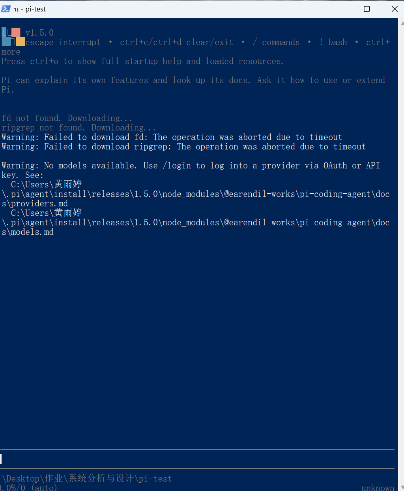

## S2 配置模型并完成会话

在 Pi 中运行 `/login`，选择 API Key 方式配置 DeepSeek。使用 `deepseek-v4-pro` 发送「你好」并收到回复，验证了模型调用。

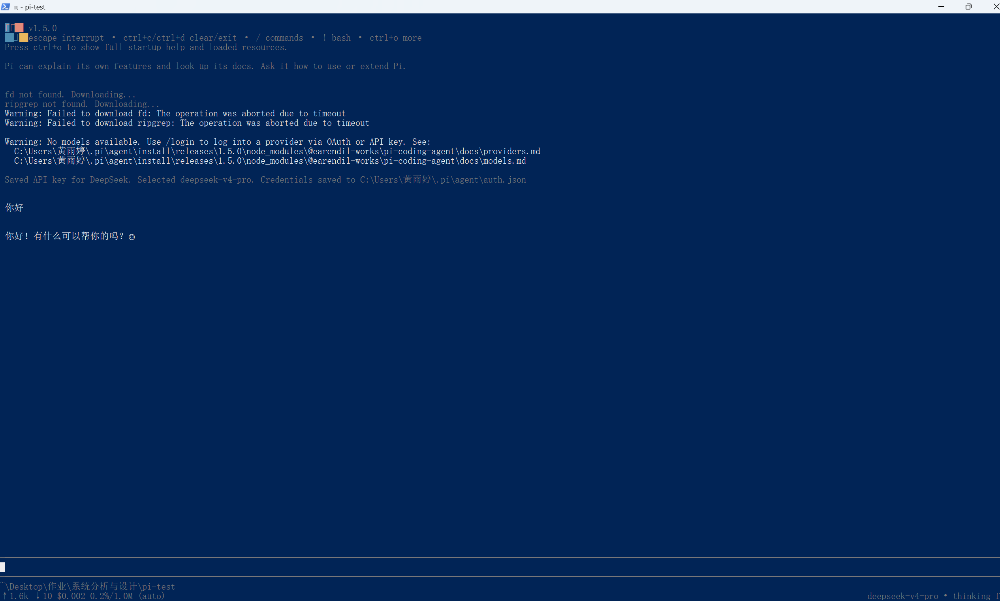

## S3 切换模型和思考级别

通过 `/model` 从 `deepseek-v4-pro` 切换到 `deepseek-flash`，发送「请用一句话解释持续集成」，验证切换后可以正常对话。

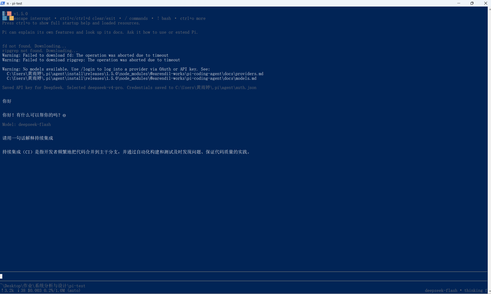

在同一个 `deepseek-flash` 模型上，将思考级别从 `low` 调到 `max`，并记录界面提示。简短的概念解释可用较低级别，复杂的代码分析可按需要提高级别。

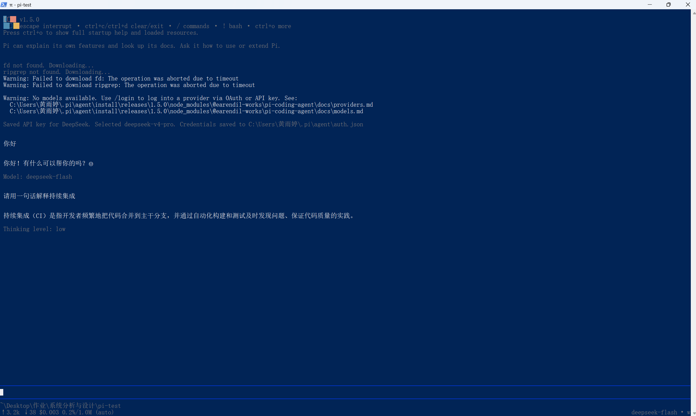

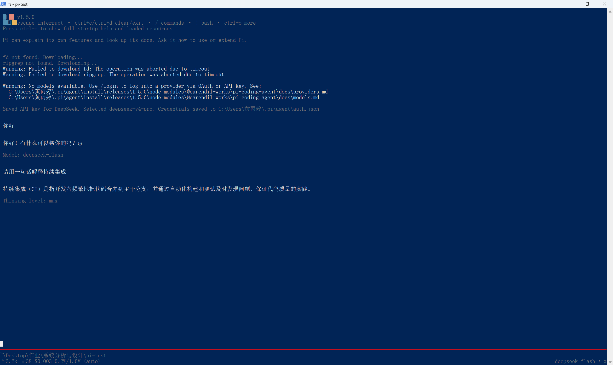

## S4 使用 @ 引用代码

在 `pi-test` 中创建 `hello.py`，安装文件搜索工具 `fd` 后，在 Pi 输入 `@hello` 并从候选列表选中 `hello.py`。Pi 读取文件，说明 `add` 函数返回两个参数的和，并指出程序会输出 `5`。

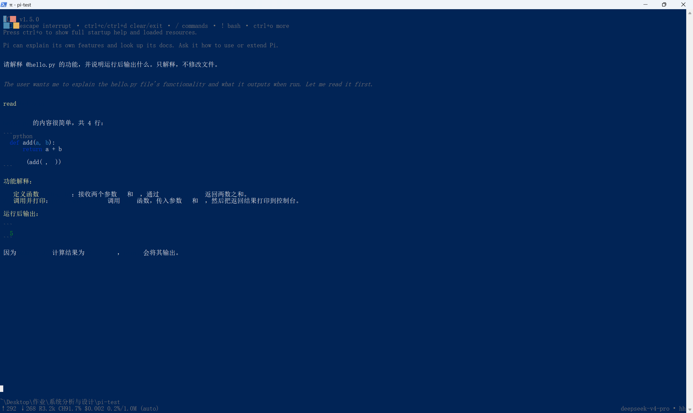

## S5 从剪贴板粘贴图片

切换到 `deepseek-flash`，把小图复制到剪贴板后粘贴进 Pi。Pi 生成了 `pi-clipboard-…png` 临时文件。模型读取图片后，识别出了白色背景、蓝色矩形和黑色数字 `7`。

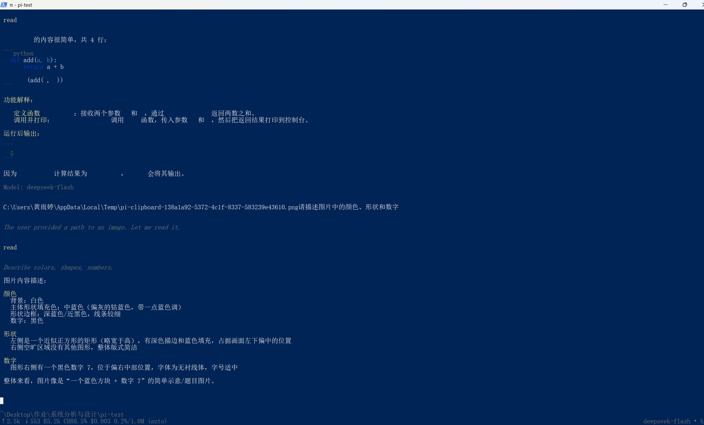

## S6 安装并调用插件

在 PowerShell 执行 `pi install npm:pi-web-access`，从 npm 安装用于网页抓取的 `pi-web-access` 扩展。安装后重新运行 `pi`，启动信息的 `[Extensions]` 下显示 `pi-web-access:dist`。 [Pi Packages 插件说明](https://pi.dev/packages/pi-web-access?name=pi)

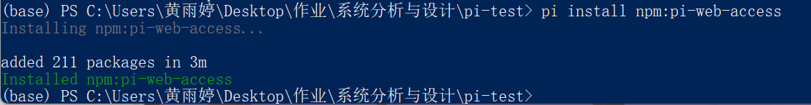

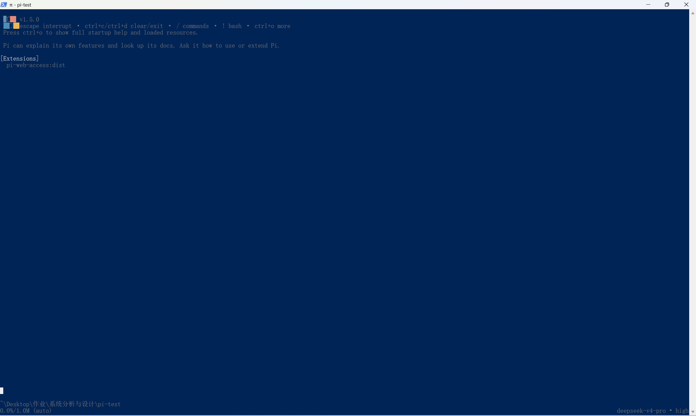

使用插件的 `fetch_content` 工具访问 `https://example.com`。首次调用提示正文提取不完整，随后以 `raw` 模式获取原始 HTML，并从 `<title>` 读出页面标题 `Example Domain`。本次抓取无需为插件配置额外的 API Key。

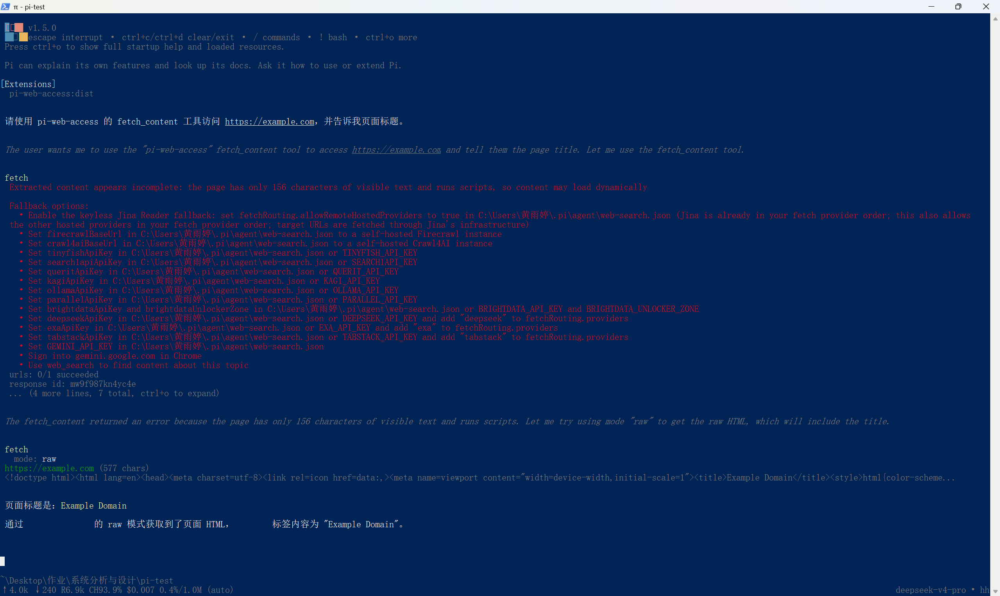

## S7 安装 PPTX Skill（选做）

从指导书指定的源提交获取完整的 `skills/pptx` 目录，并通过 Pi 安装到练习项目的 `pi-test/.pi/skills/pptx`。安装目录包含 `SKILL.md`、`LICENSE.txt` 和 `scripts/`，共 56 个文件。 [PPTX Skill 源目录](https://github.com/anthropics/skills/tree/2c5958ecac7cee2b583967a2c4981d0f4a75c579/skills/pptx)

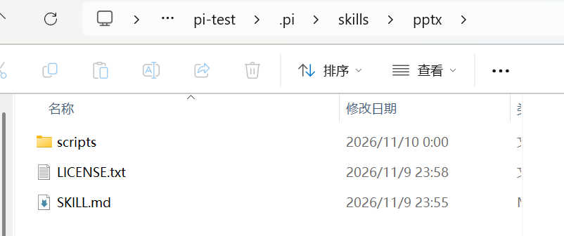

## S8 重新启动 Pi 并调用 PPTX Skill（选做）

在 `pi-test` 中重新启动 Pi，启动界面的 `[Skills]` 列表显示了项目内的 `.pi/skills/pptx/SKILL.md`。 [Pi Skill 的发现与调用](https://pi.dev/docs/latest/skills)

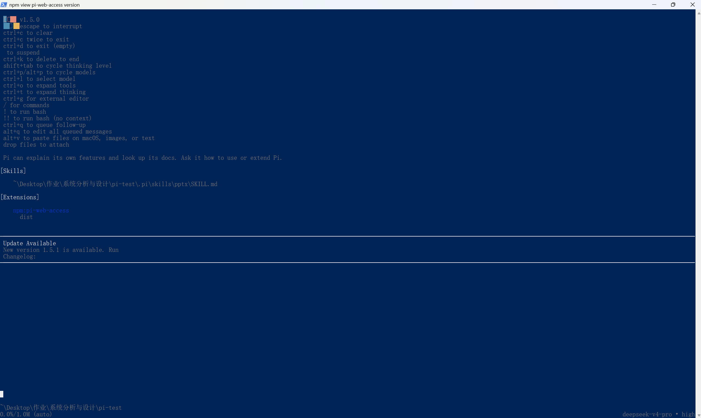

在 Pi 输入 `/skill:pptx`，并询问技能的名称、用途和 `SKILL.md` 的路径。回复说明该技能用于创建、编辑和分析 PowerPoint 演示文稿，并返回了本次安装的路径。

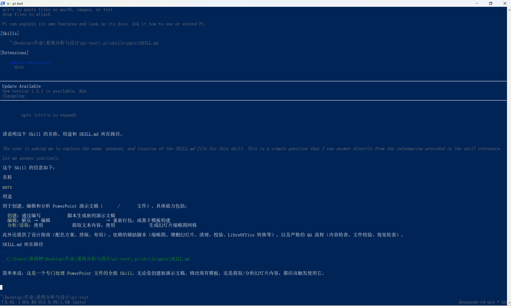
