# 实践课2 组织建仓与源码分析

## 1 基本信息

- 姓名：黄雨婷
- GitHub 登录名：`hhyt28`
- 重点分析模块：`agent`、`ai`、`coding-agent`
- 小组代码仓库：[Learning-Rate-LR/pi-hunnu-2026](https://github.com/Learning-Rate-LR/pi-hunnu-2026)
- 实际 clone 地址：`https://github.com/Learning-Rate-LR/pi-hunnu-2026.git`
- 本地源码目录：`C:\Users\黄雨婷\git-course-simple\pi-hunnu-2026`
- 分支：`main`
- 源码提交编号：`1e0fe20497ede31346957636d1ee38a2e61f69d0`
- 操作环境：Windows、PowerShell

下文的构建顺序和产物说明依据该提交中的脚本与编译配置。源码链接均固定到这个提交，便于对应本次阅读的版本。 [本次源码版本](https://github.com/Learning-Rate-LR/pi-hunnu-2026/tree/1e0fe20497ede31346957636d1ee38a2e61f69d0)

## 2 源码获取与版本确认

小组仓库位于 `Learning-Rate-LR` 组织下，网页显示为公开的 fork 仓库。我使用之前已经 clone 到本机的目录继续实验。

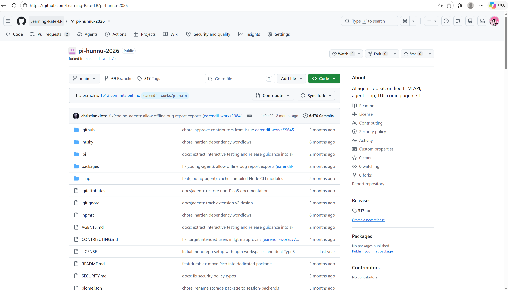

进入本地仓库后，我先检查工作区，再执行 `git switch main` 和 `git pull --ff-only origin main`。终端显示已切到 `main`，并提示 `Already up to date`。随后我运行以下命令，记录来源、分支和版本。

```powershell
Get-Location
git remote -v
git branch --show-current
git rev-parse HEAD
git status --short
Get-ChildItem -LiteralPath '.\packages' -Directory -Name
```

输出中的 `origin` 指向小组仓库，分支为 `main`。`git status --short` 没有列出改动。本次源码的 `packages/` 目录和完整提交编号也在同一张截图中。

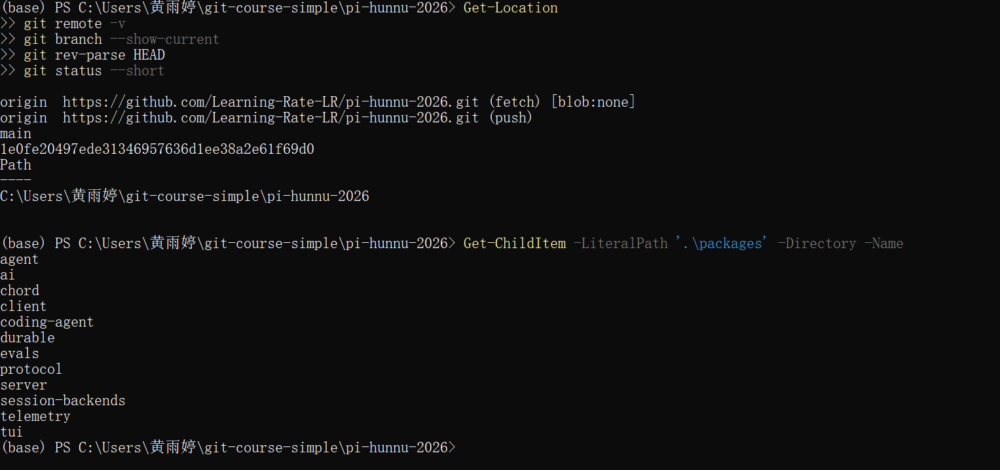

## 3 版本差异与分析范围

对照指导书的模块表，当前版本的实际目录包括 `agent`、`ai`、`chord`、`client`、`coding-agent`、`durable`、`evals`、`protocol`、`server`、`session-backends`、`telemetry`、`tui`。

其中，`schema`、`codemode`、`mcp`、`env` 在该版本中没有独立的 `packages/<模块名>` 目录。下文保留这四项的版本差异说明。当前根构建脚本还涉及 `protocol`、`client`、`server` 和 `session-backends/sqlite-node`，因此我将它们补进分析表和依赖图。`evals` 目录存在，但根 `build` 脚本没有安排它的构建步骤，它自己的 `package.json` 也没有定义 `scripts.build`。 [本次 packages 目录](https://github.com/Learning-Rate-LR/pi-hunnu-2026/tree/1e0fe20497ede31346957636d1ee38a2e61f69d0/packages)

## 4 根目录构建顺序

根目录 `package.json` 中的 `scripts.build` 定义了以下执行顺序。

```text
chord
→ tui
→ telemetry
→ ai
→ durable
→ agent
→ session-backends/sqlite-node
→ protocol
→ client
→ server
→ coding-agent
```

根脚本通过 `cd` 进入每个模块，再执行该模块的 `npm run build`。各步骤使用 `&&` 连接，前一步成功后才执行下一步。根目录另有 `build:offline`，其中对 `ai` 调用 `build:offline`，使用已有模型数据继续构建。 [根目录构建脚本](https://github.com/Learning-Rate-LR/pi-hunnu-2026/blob/1e0fe20497ede31346957636d1ee38a2e61f69d0/package.json)

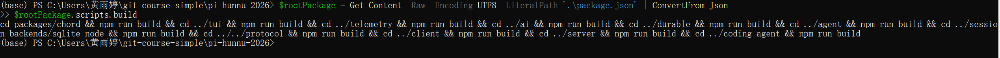

## 5 模块分析

表中的依赖使用目录名表示。例如，`@earendil-works/pi-agent-core` 对应 `packages/agent`。运行依赖取自各包的 `dependencies`。本次构建涉及的11个模块中，内部开发依赖集中在 `coding-agent`，具体列在表后。

一般编译步骤使用 `tsgo -p tsconfig.build.json`，读取模块自己的配置，再继承根 `tsconfig.base.json`。这些模块的输出目录为各自的 `dist/`。根配置开启了类型声明和源映射输出，SQLite 后端的配置也显式开启了类型声明。 [基础编译配置](https://github.com/Learning-Rate-LR/pi-hunnu-2026/blob/1e0fe20497ede31346957636d1ee38a2e61f69d0/tsconfig.base.json)

### 5.1 指导书列出的模块

| 子文件夹 | 代码主要实现什么功能 | 本模块 build 执行什么和生成什么 | 直接依赖哪些内部模块 | 依据文件或代码位置 |
|---|---|---|---|---|
| `telemetry` | 定义 `TelemetryContext`、`TelemetrySpan` 和遥测数据结构，提供空实现及内存参考实现 | 使用 `tsgo` 编译 `src/`，输出到 `dist/` | `dependencies` 中无内部包 | `packages/telemetry/README.md`、`package.json`、`tsconfig.build.json`、`src/index.ts`、`src/memory.ts` |
| `schema` | 当前版本没有独立的 `packages/schema` 目录 | 无独立包的 build 配置 | 不适用 | 该提交的 `packages/` 目录 |
| `chord` | 提供应用组合运行时，包含服务定义、插件组合、复制状态和远程服务接口 | 使用 `tsgo` 编译 `src/`，输出到 `dist/` | `dependencies` 中无内部包 | `packages/chord/README.md`、`package.json`、`tsconfig.build.json`、`src/index.ts` 导出的 `defineService`、`createFacetHost`、`replicatedState` |
| `tui` | 提供终端界面、输入组件、自动补全及差异渲染能力 | 使用 `tsgo` 按构建配置编译源码，输出到 `dist/` | `dependencies` 中无内部包 | `packages/tui/README.md`、`package.json`、`tsconfig.build.json`、`src/tui.ts`、`src/components/` |
| `codemode` | 当前版本没有独立的 `packages/codemode` 目录 | 无独立包的 build 配置 | 不适用 | 该提交的 `packages/` 目录 |
| `mcp` | 当前版本没有独立的 `packages/mcp` 目录 | 无独立包的 build 配置 | 不适用 | 该提交的 `packages/` 目录 |
| `ai` | 提供模型与提供商管理、认证解析、统一模型调用、流式输出及用量处理接口 | 先执行 `generate-models`，再执行 `build:offline`；检查模型数据、编译到 `dist/`，并将提供商数据复制到 `dist/providers/data/` | `telemetry` | `packages/ai/README.md`、`package.json`、`tsconfig.build.json`、`src/models.ts` 中的 `createModels`、`streamSimple` |
| `durable` | 当前公开接口提供会话、任务、文档等记录类型和存储接口，并提供 `MemoryStorage` 内存存储参考实现 | 使用 `tsgo` 编译 `src/`，输出到 `dist/` | `chord`、`ai` | `packages/durable/README.md`、`package.json`、`tsconfig.build.json`、`src/index.ts`、`src/types.ts`、`src/memory-storage.ts` |
| `env` | 当前版本没有独立的 `packages/env` 目录 | 无独立包的 build 配置 | 不适用 | 该提交的 `packages/` 目录 |
| `agent` | 提供有状态的 Agent、消息处理、工具执行和事件流，组织模型交互过程 | 使用 `tsgo` 编译 `src/`，输出到 `dist/`；配置通过 `paths` 引用依赖模块生成的类型声明 | `chord`、`ai`、`telemetry` | `packages/agent/README.md`、`package.json`、`tsconfig.build.json`、`src/agent.ts` 中的 `Agent`、`src/agent-loop.ts` 中的 `agentLoop` |
| `coding-agent` | 提供终端编程助手入口、交互模式、文件与命令工具集成、会话管理及扩展加载 | 先执行 `build:unbundled`，编译并复制主题、图片及 HTML 导出资源；再执行根目录打包脚本，生成 `dist/bundle/` 中的入口及相关文件 | `chord`、`agent`、`ai`、`tui`；内部开发依赖另见下文 | `packages/coding-agent/README.md`、`package.json`、`tsconfig.build.json`、`src/cli.ts`、`src/main.ts`、根目录 `scripts/build-coding-agent-bundle.mjs` |

### 5.2 当前版本补充的构建模块

| 子文件夹 | 代码主要实现什么功能 | 本模块 build 执行什么和生成什么 | 直接依赖哪些内部模块 | 依据文件或代码位置 |
|---|---|---|---|---|
| `protocol` | 定义远程会话通信的消息封装、CBOR 编解码和字节流分帧 | 使用 `tsgo` 编译 `src/`，输出到 `dist/` | `chord` | `packages/protocol/README.md`、`package.json`、`tsconfig.build.json`、`src/index.ts` 导出的 `codec.ts`、`framing.ts`、`protocol.ts` |
| `client` | 提供实验性远程会话客户端，处理连接、请求和服务传输 | 使用 `tsgo` 编译 `src/`，输出到 `dist/`；配置引用 `protocol/dist/index.d.ts` | `chord`、`protocol` | `packages/client/README.md`、`package.json`、`tsconfig.build.json`、`src/index.ts` 导出的 `Client`、`createClientServiceTransport` |
| `server` | 提供实验性本地服务端，负责服务与会话请求的路由，以及连接附着管理 | 使用 `tsgo` 编译 `src/`，输出到 `dist/` | `chord`、`agent`、`protocol` | `packages/server/README.md`、`package.json`、`tsconfig.build.json`、`src/index.ts`、`src/server.ts` |
| `session-backends/sqlite-node` | 通过 Node 的 `node:sqlite` 为 Agent 会话提供 SQLite 存储后端 | 先编译到 `dist/`，再执行 `scripts/copy-migrations.mjs`，将迁移文件复制到 `dist/sqlite/migrations/` | `ai`、`agent` | 该模块的 `README.md`、`package.json`、`tsconfig.build.json`、`src/index.ts`、`scripts/copy-migrations.mjs` |

### 5.3 依赖类别核对

我分别检查了 `dependencies`、`devDependencies` 和 `optionalDependencies`。在上述11个实际构建模块之间，共有18条 `dependencies` 依赖和3条 `devDependencies` 依赖。三条内部开发依赖均由 `coding-agent` 指向 `client`、`protocol`、`server`。这11个包的 `optionalDependencies` 中没有内部包声明。

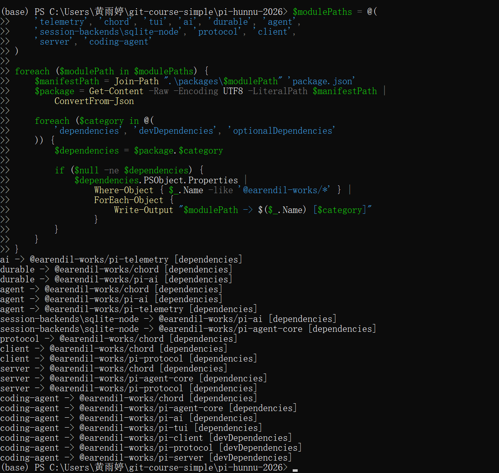

这些统计限定在本次根构建脚本涉及的11个模块之间。

## 6 模块层级与依赖关系图

我按职责把模块分为四层。`coding-agent` 作为交互入口；`agent`、`durable`、SQLite 后端、`client`、`server` 处理会话执行、记录或服务；`ai` 和 `protocol` 分别提供模型访问与通信协议；`chord`、`telemetry`、`tui` 提供可被上层使用的通用能力。这是我根据职责作出的分组，同组模块之间也可能存在依赖。

图中的箭头统一表示“使用方 → 被依赖方”。实线对应 `dependencies`，虚线对应 `devDependencies`。四个未独立建包的示例模块以版本差异说明列出。

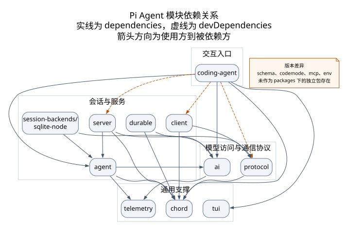

[查看可编辑的 Mermaid 图源](dependencies.mmd)

## 7 三个问题的回答

### 7.1 根目录与子模块的 npm run build 分别读取什么配置和执行什么工作

在根目录运行 `npm run build` 时，npm 读取根 `package.json` 的 `scripts.build`。本版本的根脚本依次进入各模块目录，再调用各模块自己的 `npm run build`。

子模块的命令读取当前模块的 `package.json`。例如，`agent` 执行 `tsgo -p tsconfig.build.json`，读取本模块的构建配置，并继承根 `tsconfig.base.json` 中的公共选项。`rootDir`、`include` 和 `exclude` 决定源码范围，`outDir` 决定输出位置。

有些模块还包含额外步骤。`ai` 的普通 build 先生成模型数据，再检查和编译，并复制提供商数据；`coding-agent` 在编译后复制运行资源并打包；SQLite 后端在编译后复制数据库迁移文件。因此，分析构建过程时，还需要查看 build 命令中调用的其他脚本。

### 7.2 构建顺序和模块依赖有什么关系 相邻模块是否一定互相依赖

依赖模块的编译产物需要先准备好，使用方才能读取对应的类型声明或其他产物。例如，`agent/tsconfig.build.json` 将 `pi-ai`、`pi-telemetry` 和 `chord` 映射到各自的 `dist` 类型声明，因此根脚本把这三个模块安排在 `agent` 前。`client` 也通过构建配置引用了 `protocol/dist/index.d.ts`。

顺序中相邻的模块可以是彼此独立的构建步骤。例如，根脚本先构建 `chord`、再构建 `tui`，而本次 `tui/package.json` 的运行依赖中没有 `chord`。我根据依赖声明和编译配置判断关系，执行顺序用于核对产物准备的先后。

### 7.3 至少三个模块的依赖路径如何分工

我选择的路径是 `coding-agent → agent → ai`。

`coding-agent/src/cli.ts` 调用 `main` 处理命令行入口；`core/sdk.ts` 导入 `Agent` 并创建实例，接入会话和应用层配置。`agent/src/agent.ts` 中的 `Agent` 保存状态并提供 `prompt` 等接口，`agent-loop.ts` 组织交互循环和工具调用。`ai/src/models.ts` 中的 `createModels` 创建模型集合，`streamSimple` 处理上下文和认证，再把请求交给对应提供商。这样，上层的终端与会话逻辑通过 Agent 执行过程使用模型接口。

这条路径同时有两项直接依赖声明作为依据，分别是 `coding-agent/package.json` 对 `pi-agent-core` 的依赖，以及 `agent/package.json` 对 `pi-ai` 的依赖。

- [coding-agent 中创建 Agent 的代码](https://github.com/Learning-Rate-LR/pi-hunnu-2026/blob/1e0fe20497ede31346957636d1ee38a2e61f69d0/packages/coding-agent/src/core/sdk.ts)
- [Agent 执行接口](https://github.com/Learning-Rate-LR/pi-hunnu-2026/blob/1e0fe20497ede31346957636d1ee38a2e61f69d0/packages/agent/src/agent.ts)
- [模型管理和流式调用代码](https://github.com/Learning-Rate-LR/pi-hunnu-2026/blob/1e0fe20497ede31346957636d1ee38a2e61f69d0/packages/ai/src/models.ts)

## 8 模块阅读截图

以下是查看各模块文档、配置和源码目录时的截图。

<details>
<summary>agent 的构建配置和源码阅读</summary>

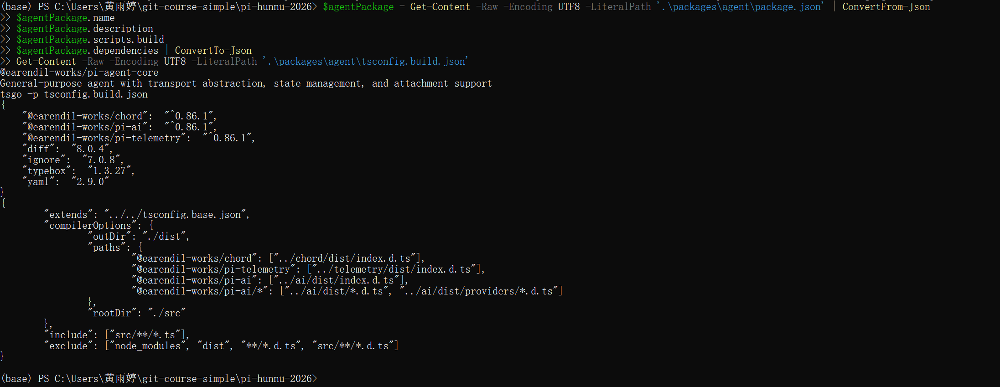

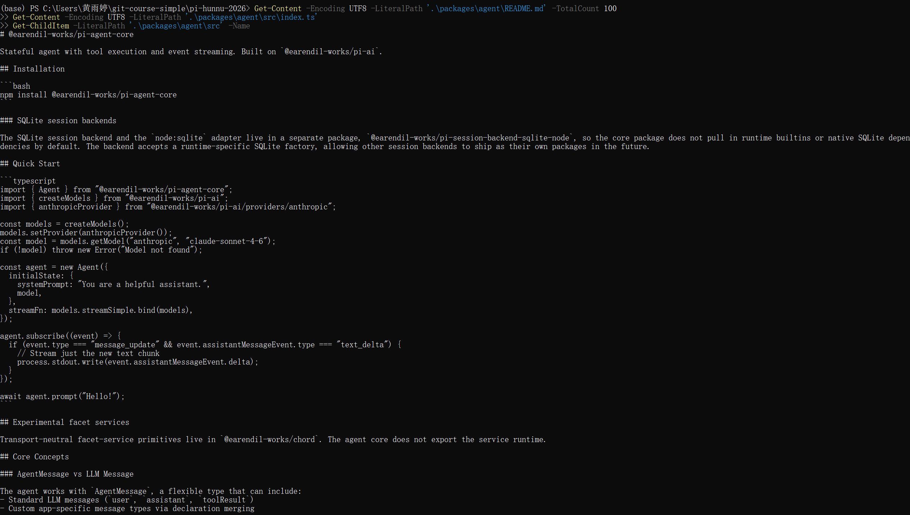

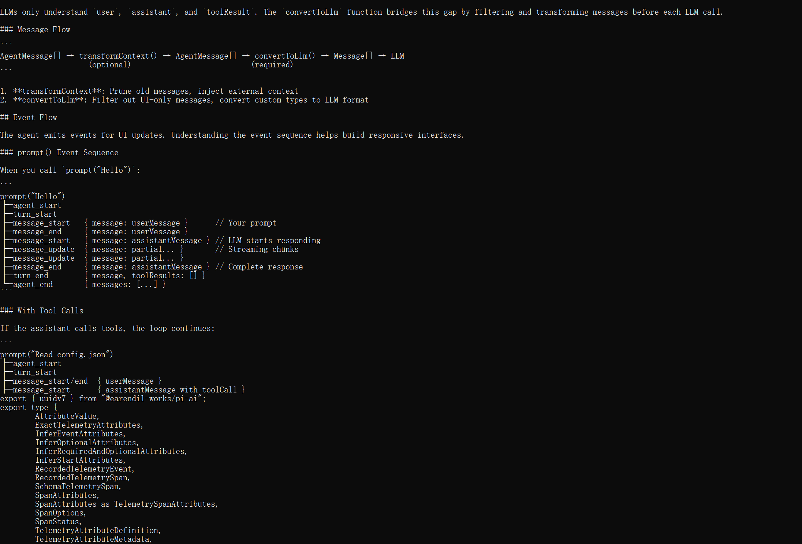

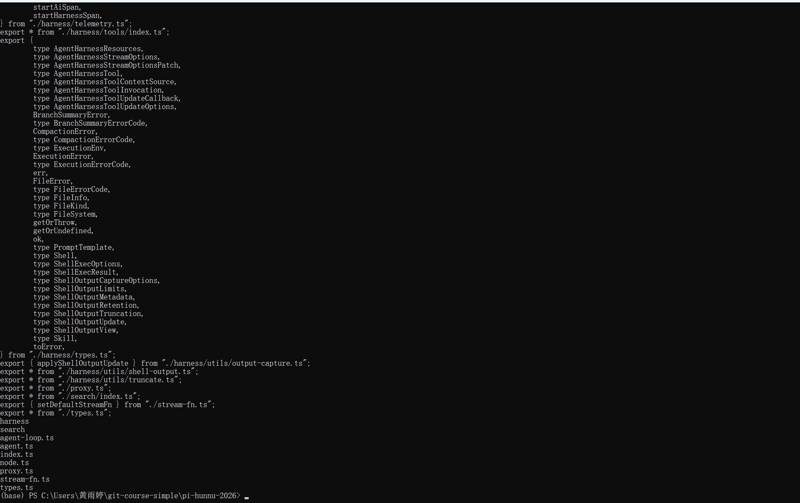

</details>

<details>
<summary>ai 的构建配置和源码阅读</summary>

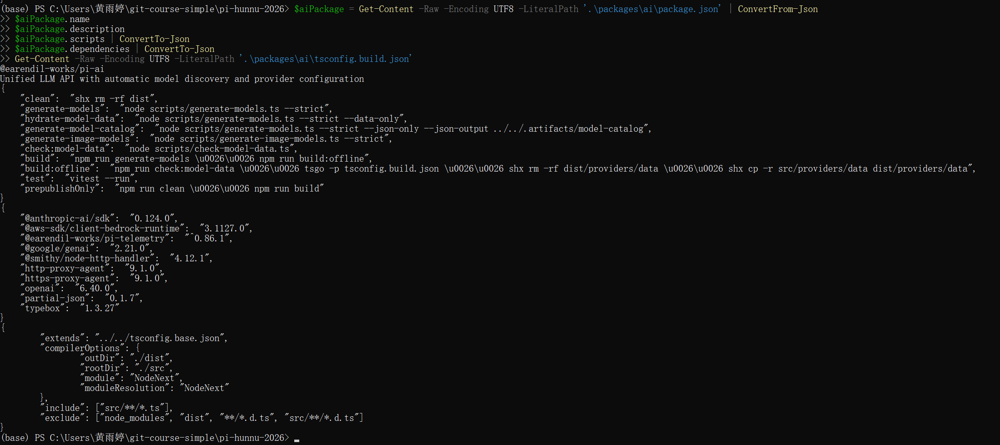

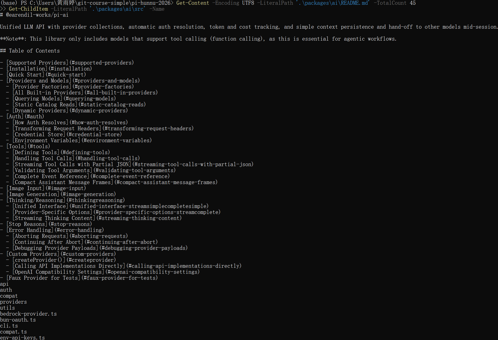

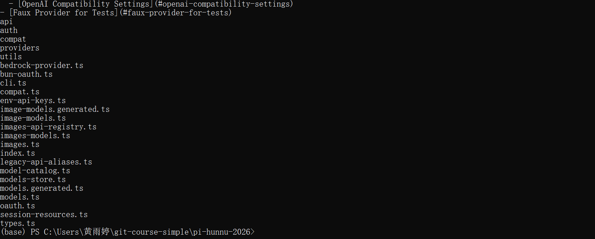

</details>

<details>
<summary>coding-agent 的构建配置和源码阅读</summary>

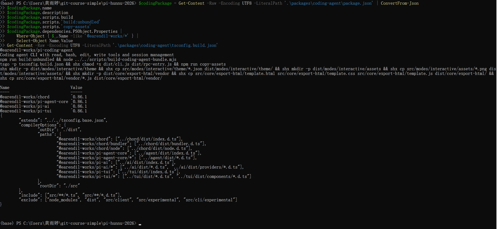

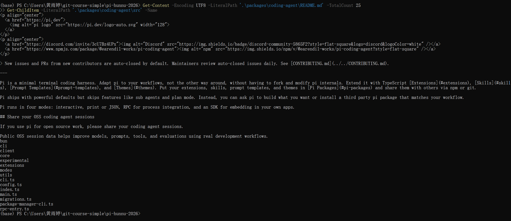

</details>

<details>
<summary>telemetry chord tui durable 的阅读记录</summary>

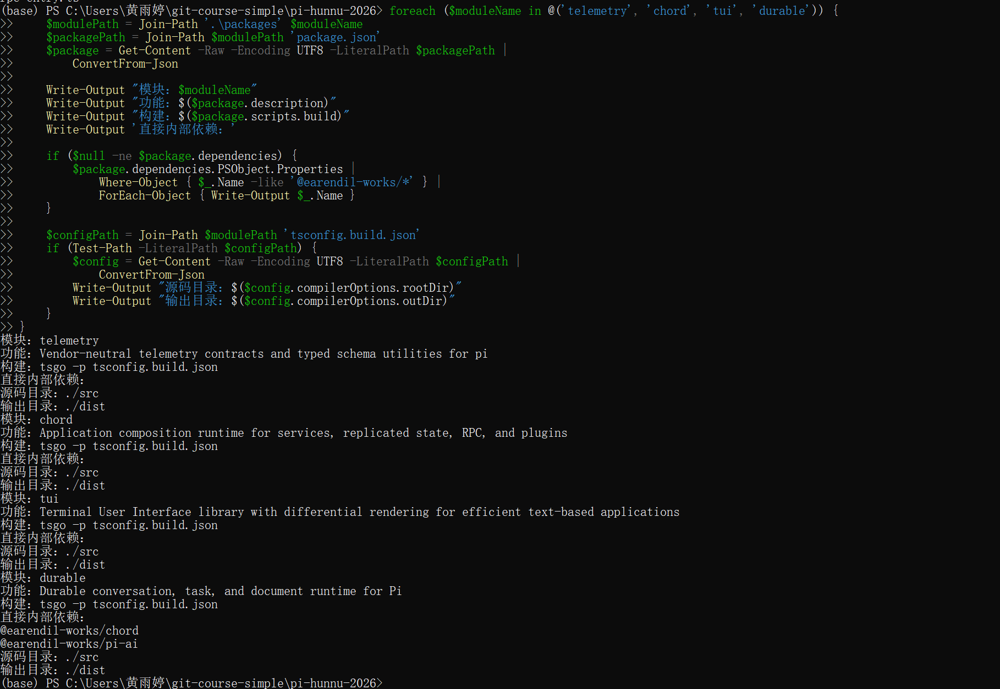

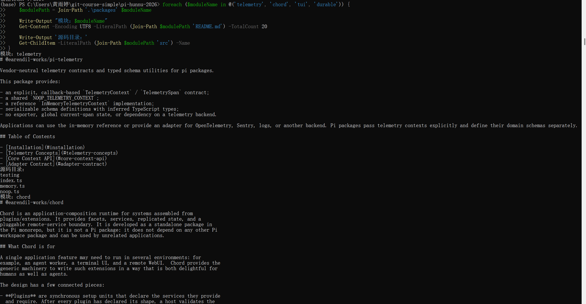

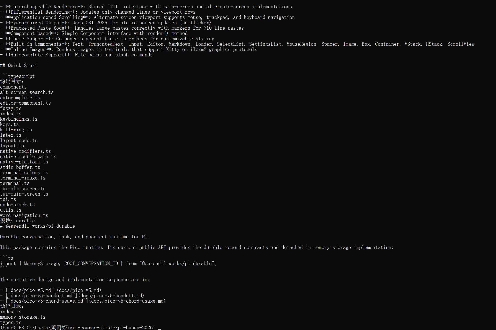

</details>

<details>
<summary>protocol 和 SQLite 后端的配置阅读</summary>

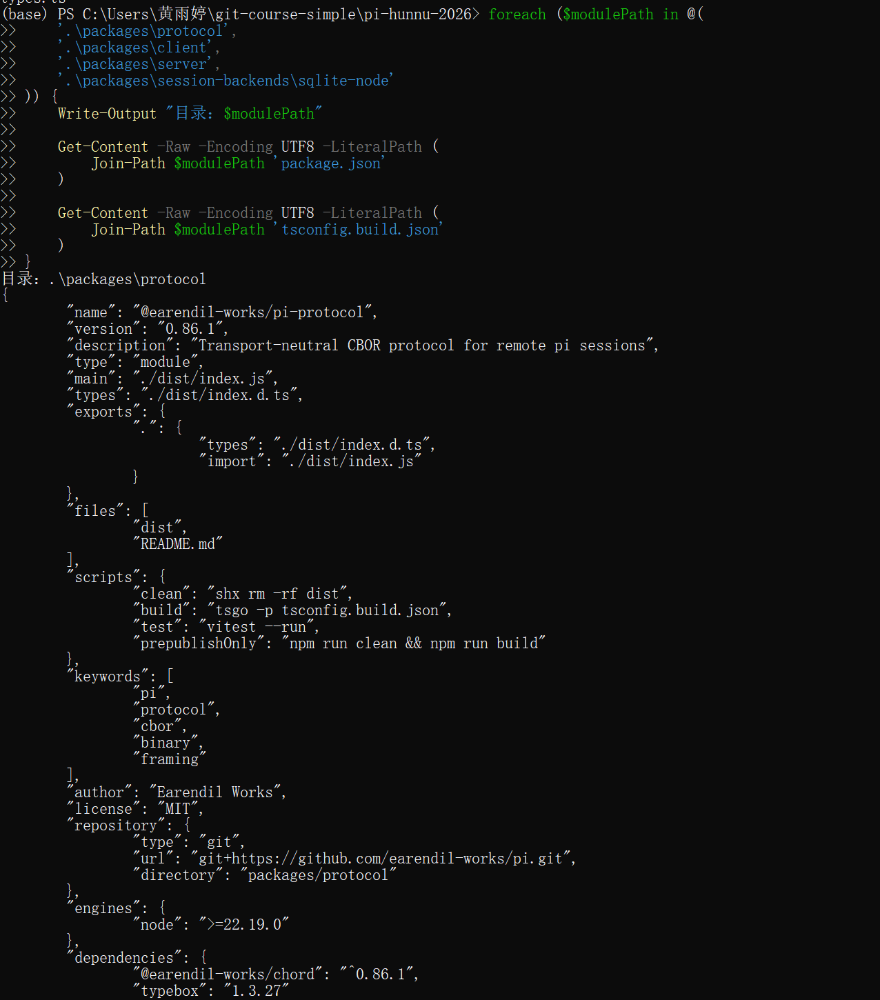

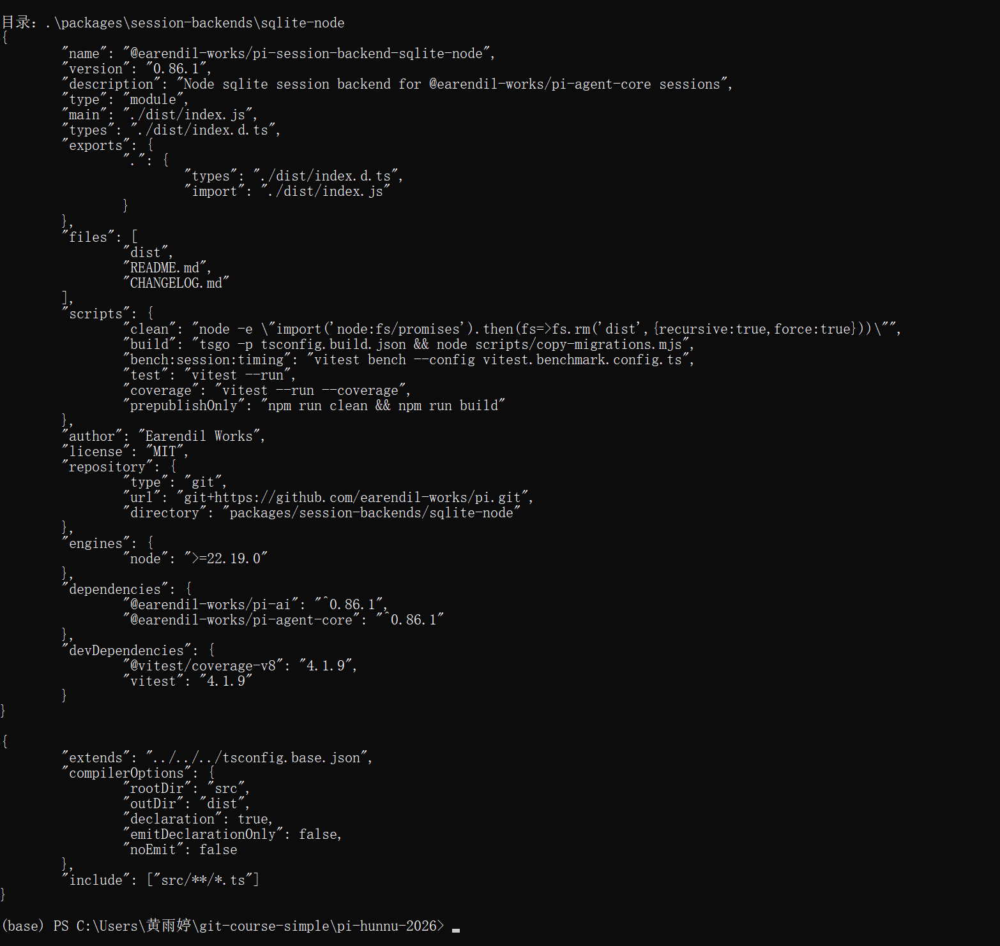

</details>

## 9 阅读体会

通过这次源码阅读，我对各模块的分工和构建过程有了更清楚的认识。例如，`pi-agent-core` 对应的是 `agent` 目录，构建顺序中相邻的模块也不一定互相依赖。模块的功能还需要结合具体实现判断，像 `durable` 当前提供的是记录类型、存储接口和内存存储实现，不能只根据名称判断它已经实现了哪些功能。
