# 实践课3 Pi Agent源码安装与编译

## 1 基本信息

- 姓名：黄雨婷
- GitHub 登录名：`hhyt28`
- 小组仓库：[Learning-Rate-LR/pi-hunnu-2026](https://github.com/Learning-Rate-LR/pi-hunnu-2026)
- 实际 clone 地址：`https://github.com/Learning-Rate-LR/pi-hunnu-2026.git`
- 本地源码目录：`C:\Users\黄雨婷\git-course-simple\pi-hunnu-2026`
- 分支：`main`
- 基础提交编号：`1e0fe20497ede31346957636d1ee38a2e61f69d0`
- Pi 版本：`0.86.1`
- 操作环境：Windows、PowerShell

本次继续使用第二次实践中下载的小组源码，完成依赖安装、编译和本地源码运行。首次构建遇到了 OpenCode Go 提供商的类型错误，修改 `packages/ai/src/providers/opencode-go.ts` 后重新构建成功。上述提交编号表示修改前的基础版本，修复保留在本地工作区，尚未提交到小组仓库。

## 2 开发工具检查（S1）

进入源码目录后，执行以下命令检查工具版本。

```powershell
Set-Location -LiteralPath 'C:\Users\黄雨婷\git-course-simple\pi-hunnu-2026'
node --version
npm --version
git --version
```

| 工具 | 实际版本 |
|---|---|
| Node.js | `v24.18.0` |
| npm | `11.16.0` |
| Git | `2.55.0.windows.2` |

Node.js 24 系列符合指导书的建议，也满足该源码根 `package.json` 中 `>=22.19.0` 的要求。

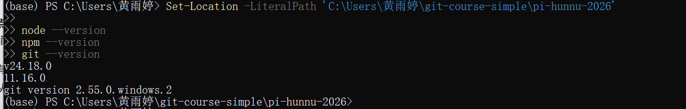

## 3 源码来源与版本确认（S2）

源码已经在上次实践中下载，因此沿用现有目录。执行以下命令确认来源和版本。

```powershell
Get-Location
git remote -v
git branch --show-current
git rev-parse HEAD
git status --short
```

`origin` 的获取和推送地址均指向 `Learning-Rate-LR/pi-hunnu-2026.git`，当前分支为 `main`。开始安装前，`git status --short` 没有输出，工作区没有未提交的改动。

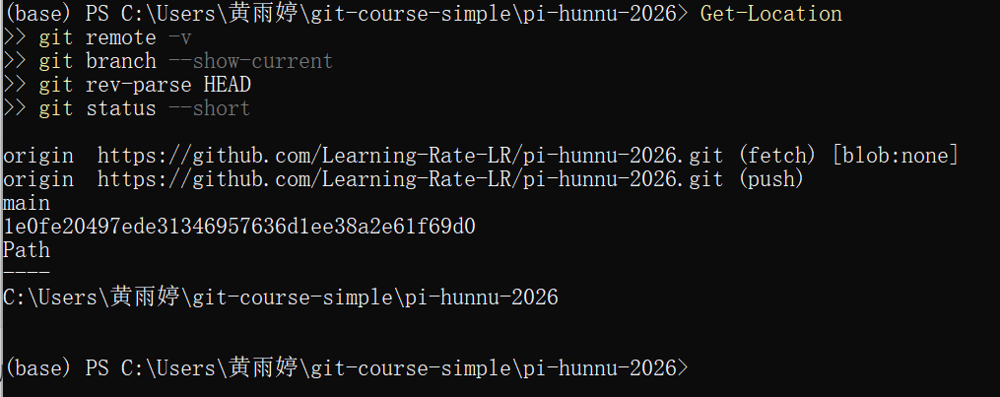

## 4 安装与编译配置（S3）

根目录的 `package.json` 定义了 Node.js 版本要求、工作区和构建脚本。`package-lock.json` 记录依赖版本与关系，`packages/` 保存工作区中的各个子包。CLI 包的 `package.json` 则定义了自己的构建命令，以及 `bin.pi` 对应的 `dist/bundle/cli.js` 入口。

根 `README.md` 的 `Development` 部分给出了 `npm install --ignore-scripts`、`npm run build` 和 `npm run build:offline` 等开发命令，另外还列出了代码检查、测试及源码运行入口。本次依赖安装和构建采用其中的前两条命令，Windows 下的源码运行使用 `pi-test.bat`。

我使用 PowerShell 读取根配置中的版本要求和构建命令。

```powershell
$rootPackage = Get-Content -Raw -Encoding UTF8 -LiteralPath '.\package.json' | ConvertFrom-Json
$rootPackage.engines.node
$rootPackage.scripts.build
```

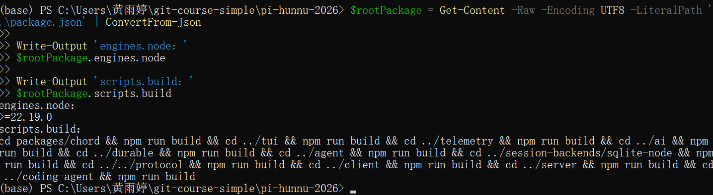

Node.js 的最低版本要求写在 `engines.node` 中。根目录运行 `npm run build` 时，npm 读取根 `package.json` 的 `scripts.build`。该脚本依次进入下列模块，再执行各模块自己的 build。

```text
chord → tui → telemetry → ai → durable → agent
→ session-backends/sqlite-node → protocol → client → server → coding-agent
```

各步骤由 `&&` 连接，前一步成功后才继续下一步。大部分模块使用 `tsgo` 编译 TypeScript；`ai` 还生成和检查模型目录数据，`coding-agent` 还复制资源并打包。

## 5 安装项目依赖（S4）

在源码仓库根目录执行：

```powershell
npm install --ignore-scripts
$installExitCode = $LASTEXITCODE
Write-Output "安装退出码：$installExitCode"
```

这个命令根据项目声明和锁文件安装依赖，在本地建立 `node_modules` 并关联工作区包。锁文件与声明一致时使用锁定版本。`--ignore-scripts` 跳过安装阶段自动触发的生命周期脚本，例如 `prepare`，后续仍可主动执行 `npm run build`。这里安装的是当前项目的依赖，不会把源码版本自动安装为全局 `pi` 命令。

安装结果显示新增336个包，审计358个包，退出码为 `0`。

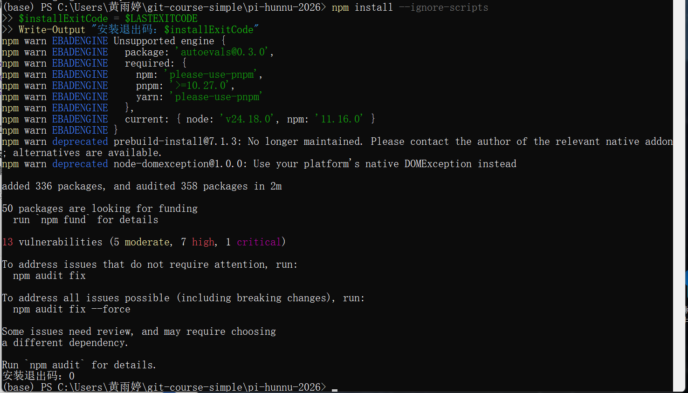

安装过程中出现了以下提示：

| 提示 | 实际情况与处理 |
|---|---|
| `EBADENGINE` | `autoevals@0.3.0` 的 `engines` 声明要求使用 pnpm，当前使用 npm，因此出现包管理器要求不匹配的警告。截图中的这条警告不是 Node.js 版本过低。继续按课程的 npm 流程操作，安装最终返回0。 |
| `deprecated` | `prebuild-install@7.1.3` 和 `node-domexception@1.0.0` 出现弃用提示。记录提示并继续观察安装结果。 |
| `vulnerabilities` | 审计报告13个漏洞，包括5个中危、7个高危和1个严重漏洞。没有执行 `npm audit fix --force`，避免在实验过程中直接改变依赖版本；这些审计问题尚未解决。 |

## 6 首次构建失败及解决过程

### 6.1 首次构建

执行根目录的构建命令，并保存退出码。

```powershell
npm run build
$buildExitCode = $LASTEXITCODE
Write-Output "构建退出码：$buildExitCode"
```

日志先进入 `chord`、`tui`、`telemetry`，随后进入 `ai`，执行模型目录生成脚本。

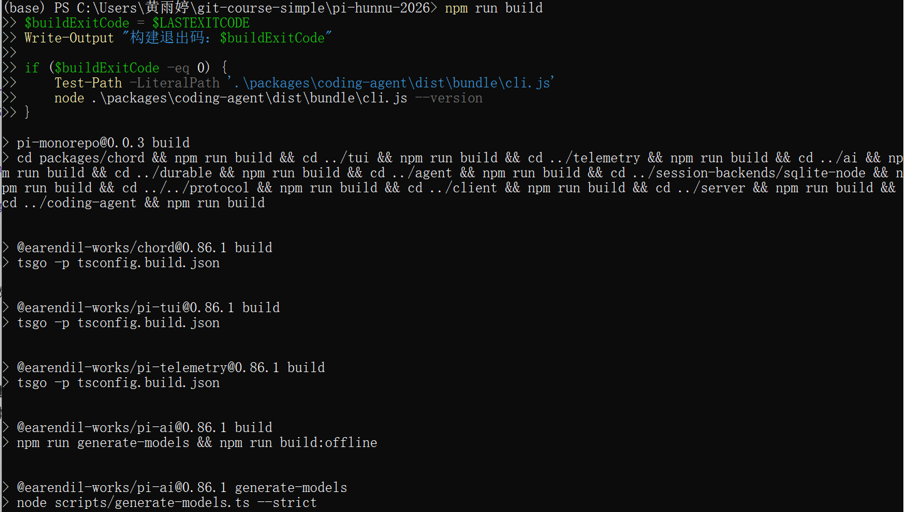

模型数据检查显示 `Generated model data is valid`，但后续 TypeScript 编译在 `src/providers/opencode-go.ts:14:3` 报出 `TS2322`，根构建退出码为 `1`。

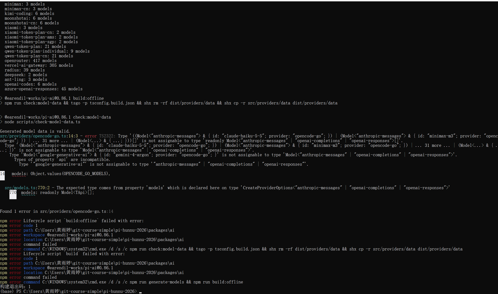

### 6.2 原因分析

报错指出，生成的 OpenCode Go 模型目录中包含 `google-generative-ai` 类型的模型，例如 `gemini-4-argon`。但当前 `opencodeGoProvider` 的返回类型和 `createProvider` 的类型参数只声明了 `anthropic-messages`、`openai-completions`、`openai-responses`，`api` 映射中也没有 Google Generative AI 处理器。

因此，模型列表中的实际类型超出了提供商声明的范围，导致类型检查失败。模型数据检查通过并不表示整个编译已经成功。

### 6.3 修改与验证

在 `packages/ai/src/providers/opencode-go.ts` 中补充了以下内容：

1. 导入已有的 `googleGenerativeAIApi`。
2. 在 `Provider` 和 `createProvider` 的类型参数中加入 `google-generative-ai`。
3. 在 `api` 映射中加入 `withOpenCodeSessionHeader(googleGenerativeAIApi())`。

修改后，通过 `git diff -- packages/ai/src/providers/opencode-go.ts` 查看差异。

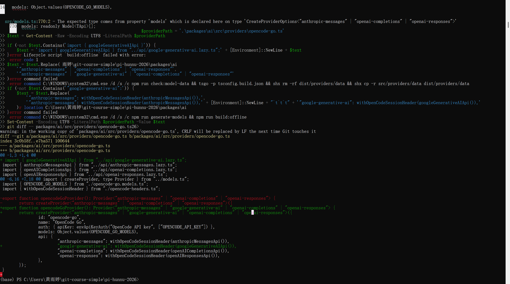

这一处理方式也与[上游 OpenCode Go 提供商的实现](https://github.com/earendil-works/pi/blob/main/packages/ai/src/providers/opencode-go.ts)一致。修改的是提供商源码，没有删除报错模型，也没有使用类型断言绕过检查。截图中的 `CRLF will be replaced by LF` 是换行符提示，与本次 `TS2322` 类型错误不同。

## 7 重新构建与产物验证（S5）

修复后，再次从仓库根目录执行完整构建，并检查编译产物。

```powershell
npm run build
$buildExitCode = $LASTEXITCODE
Write-Output "构建退出码：$buildExitCode"

if ($buildExitCode -eq 0) {
    Test-Path -LiteralPath '.\packages\coding-agent\dist\bundle\cli.js'
    node .\packages\coding-agent\dist\bundle\cli.js --version
}
```

这次模型目录生成和检查通过，构建继续进入后续模块，最终完成 CLI 打包。

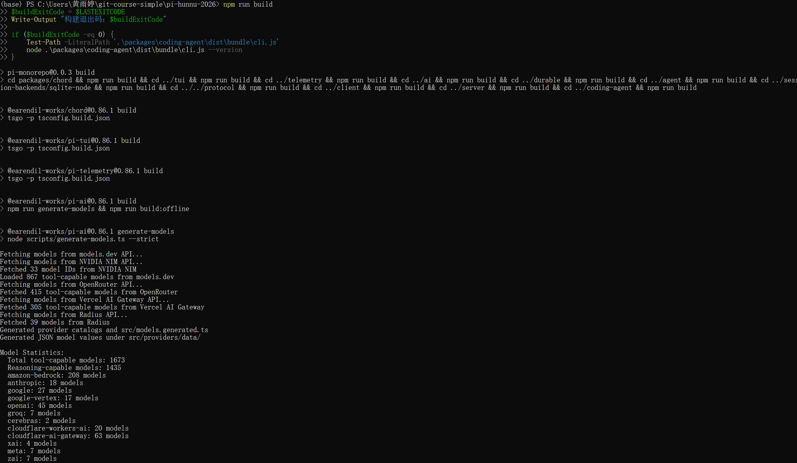

最终日志显示 `Built packages\coding-agent\dist\bundle (56 files, 8.3 MiB)`，检查结果如下。

| 检查内容 | 实际结果 |
|---|---|
| 根构建退出码 | `0` |
| `dist/bundle/cli.js` 是否存在 | `True` |
| 通过本地编译产物运行 `--version` | `0.86.1` |

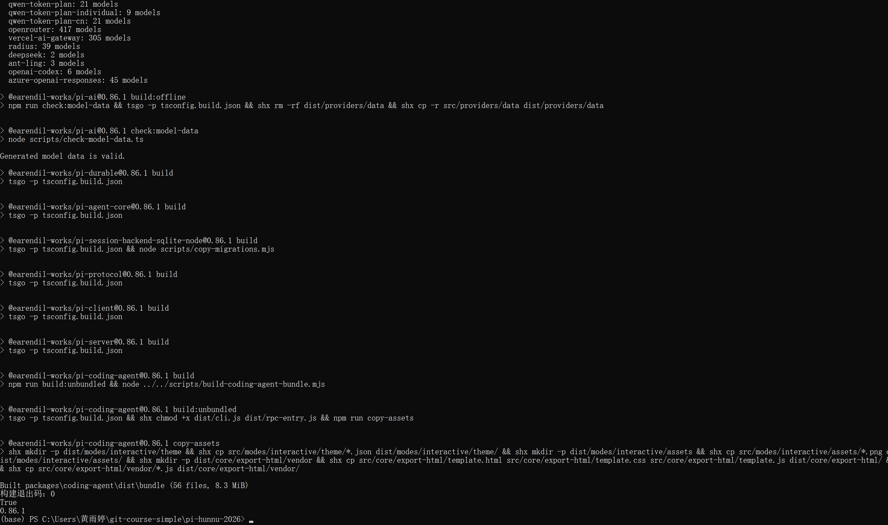

本次实际执行的两轮根构建命令均为 `npm run build`。日志中的 `ai build:offline` 是 AI 包普通 build 内部调用的步骤。

## 8 本地源码运行与会话（S6）

先在仓库根目录验证源码入口的版本。

```powershell
.\pi-test.bat --version
```

输出为 `0.86.1`，与编译产物的版本一致。

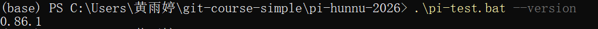

随后启动交互界面。

```powershell
.\pi-test.bat
```

进入界面后输入：

```text
请用一句话说明源码和编译产物的区别。只回答问题，不修改文件。
```

界面显示 `pi v0.86.1`，模型为 `deepseek-v4-pro`，并实际返回了关于源码与编译产物区别的回答。截图保留了启动命令、提示词和回复。

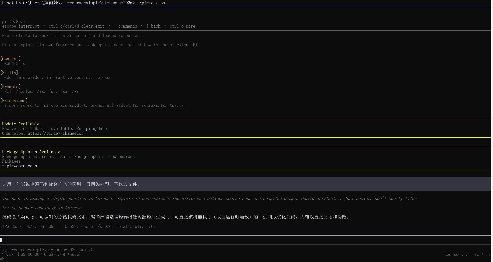

### 如何确认运行的是本地源码

启动时使用的是当前源码仓库中的 `.\pi-test.bat`。该批处理调用同目录的 `pi-test.ps1`，PowerShell 脚本再调用仓库内的 `node_modules/.bin/tsx.cmd`，运行 `packages/coding-agent/src/cli.ts`。因此，判断依据是本地启动路径和脚本实际调用的源码入口，而不只是版本号。

### 两种入口分别适合什么场景

- `.\pi-test.bat`：通过仓库中的 tsx 运行 TypeScript 源码，适合本地开发和观察源码修改后的行为。这里的脚本名称虽然包含 test，但本次执行的是源码启动入口，没有运行整个项目测试套件。
- `node .\packages\coding-agent\dist\bundle\cli.js`：运行构建生成的 JavaScript 入口，适合检查编译、资源复制和打包结果。修改源码后，需要重新构建才能更新这份产物。

本项目的编译产物入口是 JavaScript 文件，由 Node.js 加载运行。本次没有构建独立 EXE，也没有下载大模型权重；构建日志中的模型数据是模型目录和能力等配置数据。

## 9 实验体会

这次实验中，我先完成依赖安装，再编译并验证入口，最后启动本地源码进行对话。安装退出码为0之后，构建仍然可能遇到源码类型错误，因此需要分别检查每个阶段的结果。遇到 `TS2322` 时，结合模型目录和提供商源码才找到了类型声明不一致的原因。修复后，通过根构建退出码、入口文件和版本命令确认了编译结果，并完成了一次实际会话。

这也让我更清楚地理解了源码、依赖和编译产物各自的作用。排查问题时，需要先判断错误发生在哪一步，再查看对应的配置和代码，而不是一遇到报错就重新安装。记录失败输出、修改差异和验证结果，也能让解决过程更完整，便于以后遇到类似问题时回头查阅。

同时，通过本地路径启动程序，也让我能够区分正在验证的是源码版本、编译产物还是原来安装的全局版本。
