# 实践课4 Pi Agent模型调用与运行流程

## 1 基本信息

- 姓名：黄雨婷
- GitHub 登录名：`hhyt28`
- 小组仓库：[Learning-Rate-LR/pi-hunnu-2026](https://github.com/Learning-Rate-LR/pi-hunnu-2026)
- 本地源码目录：`C:\Users\黄雨婷\git-course-simple\pi-hunnu-2026`
- 分支：`main`
- 基础提交编号：`1e0fe20497ede31346957636d1ee38a2e61f69d0`
- 本地 Pi 版本：`0.86.1`
- 两次对比会话使用的模型：`deepseek-v4-pro`，思考级别为 `high`

本次在第三次实践已构建的项目中增加两行日志，重新编译后，对比直接问答和读取文件两种运行过程。第三次实践中对 `opencode-go.ts` 的修复继续保留；本次新增的日志修改尚未提交到小组仓库，上述编号表示基础提交。

## 2 源码修改

修改文件为 `packages/agent/src/agent-loop.ts`。本地行号与指导书示例不同，通过搜索对应语句定位。

### 2.1 模型调用前的日志（S1）

在 `streamAssistantResponse` 中，紧接着解析 API Key 的代码之后、调用 `streamFunction` 之前增加日志。保存后的源码中，日志位于第362行，调用位于第363行，原有调用参数保留。

```typescript
console.error("[P4] Agent 即将请求模型");
const response = await streamFunction(config.model, llmContext, {
    ...config,
    apiKey: resolvedApiKey,
    signal,
});
```

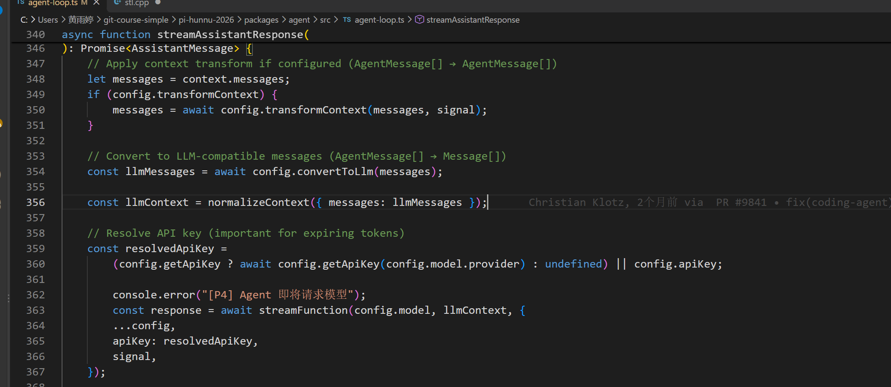

### 2.2 工具结果写入上下文后的日志（S2）

在 `runLoop` 中，将日志加在 `currentContext.messages.push(result)` 下方，保留在 `for` 循环内部。保存后的源码中，日志位于第245行。

```typescript
for (const result of toolResults) {
    currentContext.messages.push(result);
    console.error("[P4] 工具结果已加入上下文");
    newMessages.push(result);
}
```

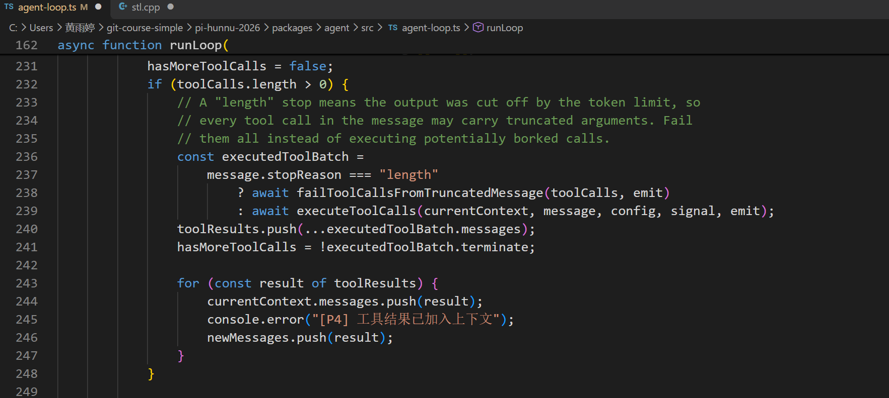

两行日志分别记录一次模型请求前的位置和一条工具结果加入上下文的位置。修改保存后，重新构建的 `packages/agent/dist/agent-loop.js` 中也包含这两条日志。

## 3 重新编译与启动

### 3.1 根目录构建（S3）

在包含根 `package.json` 的源码目录执行：

```powershell
npm run build
```

前面的尝试遇到过网络错误，具体记录见第7节。后续再次执行普通构建时，联网获取模型目录成功，根脚本继续完成各模块编译及 CLI 打包。

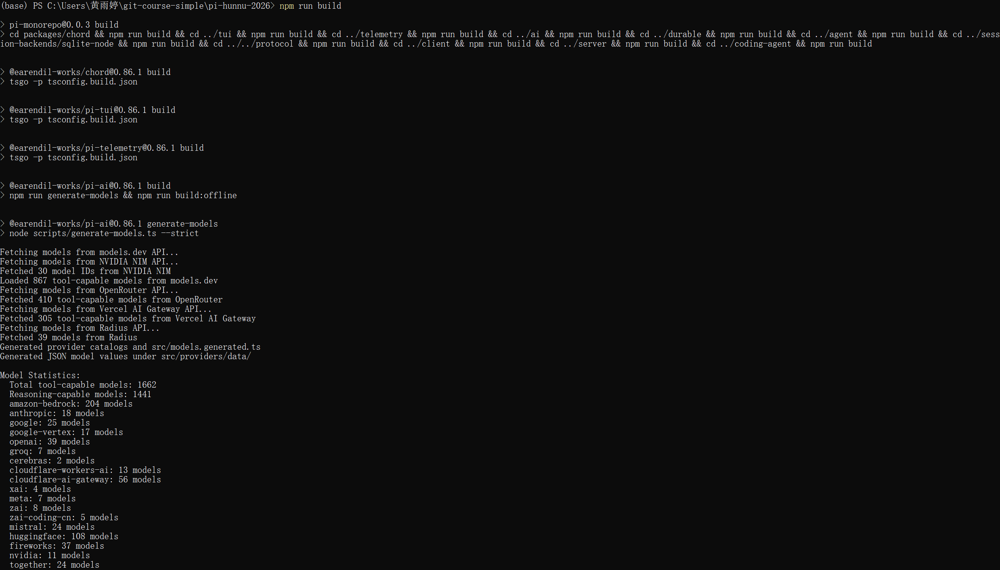

最终输出 `Built packages\coding-agent\dist\bundle (56 files, 8.3 MiB)`，随后返回 PowerShell 提示符。

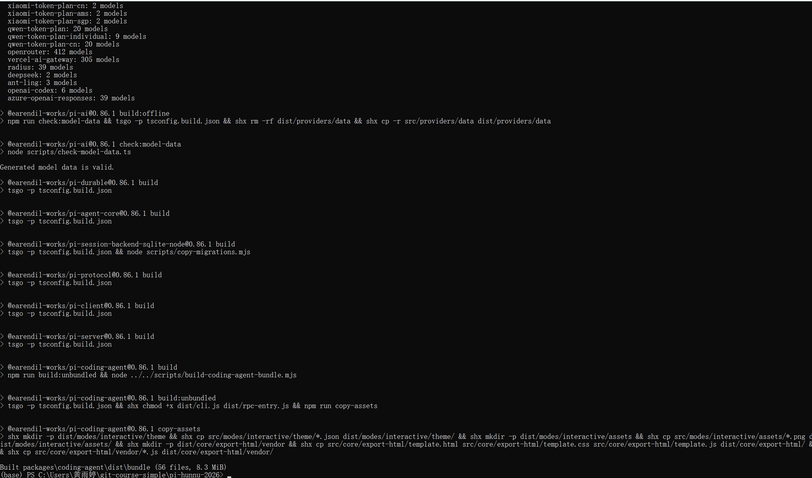

紧接着执行 `$LASTEXITCODE`，输出为 `0`。本次最终成功的根构建命令是 `npm run build`；日志中 AI 包的 `build:offline` 是其普通 build 内部调用的步骤。

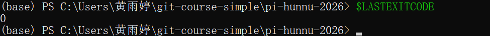

### 3.2 启动编译产物（S4）

```powershell
node .\packages\coding-agent\dist\cli.js
```

启动后显示 `pi v0.86.1`，当前工作目录为小组源码根目录，模型为 `deepseek-v4-pro`。

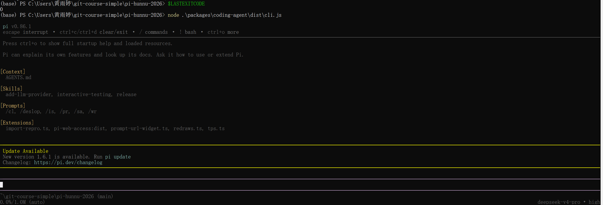

## 4 会话 A：直接问答（S5）

为了保留实际日志，在新的会话中通过 `cmd` 重定向标准错误输出。启动的仍是同一个本地编译入口。

```powershell
cmd /d /c "node .\packages\coding-agent\dist\cli.js 2> practice4-A-utf8.log"
```

输入指令：

```text
请直接用一句话解释什么是 Git 分支。
```

最终回复：

> Git 分支是仓库中一条独立的开发线，让你在不影响主干代码的情况下并行开发新功能、修复 bug 或做实验，最后再合并回主干。

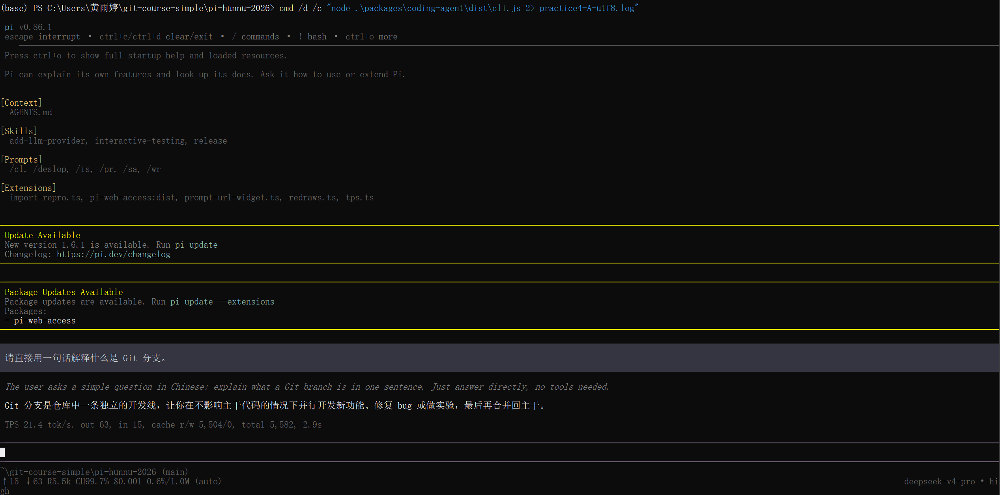

回复完成后退出 Pi，以 UTF-8 读取日志并筛选 `[P4]`。实际只有下面一条日志，没有工具结果入上下文日志，界面也没有工具执行记录。

```text
[P4] Agent 即将请求模型
```

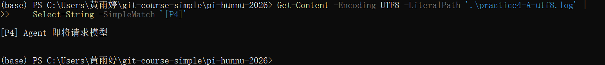

会话 A 未调用工具，进入了 **1轮模型调用**，随后直接返回文字回复。[会话 A 原始日志](practice-04/practice4-A-utf8.log)

## 5 会话 B：读取文件（S6）

### 5.1 准备实验文件

在项目根目录创建 `practice4.txt`，写入一行实验代号并读取确认。

```powershell
Set-Content -Encoding UTF8 -LiteralPath '.\practice4.txt' -Value 'HYT-P4-20261126'
Get-Content -Encoding UTF8 -LiteralPath '.\practice4.txt'
```

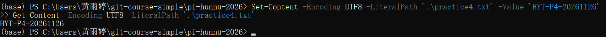

[本次实验文件副本](practice-04/practice4.txt)

### 5.2 新会话读取文件

退出 A 后，重新启动新的会话，继续使用 `deepseek-v4-pro` 和 `high` 思考级别。B 的日志保存到另一份文件。

```powershell
cmd /d /c "node .\packages\coding-agent\dist\cli.js 2> practice4-B-utf8.log"
```

输入时只提供文件名，没有提供实验代号：

```text
请用 read 工具读取当前目录的 practice4.txt，并告诉我文件中的实验代号。
```

界面出现一次 `read practice4.txt:1` 记录，最终回复中给出的实验代号为 `HYT-P4-20261126`，与文件内容一致。

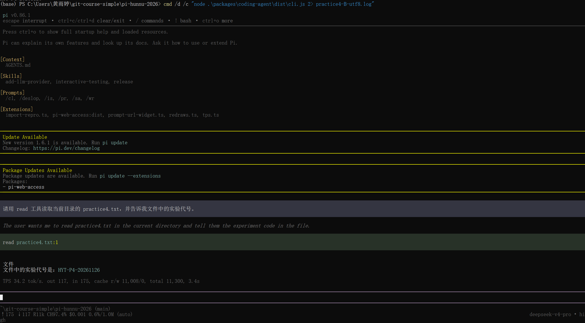

### 5.3 实际日志顺序

退出后执行：

```powershell
Get-Content -Encoding UTF8 -LiteralPath '.\practice4-B-utf8.log' |
    Select-String -SimpleMatch '[P4]'
```

按实际出现顺序记录为：

```text
[P4] Agent 即将请求模型
[P4] 工具结果已加入上下文
[P4] Agent 即将请求模型
```

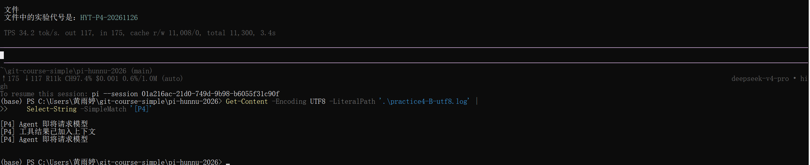

会话 B 调用了一次 `read`，写入了一条工具结果，并进入 **2轮模型调用**。[会话 B 原始日志](practice-04/practice4-B-utf8.log)

## 6 两次会话的对比与运行流程

| 对比项 | A：直接问答 | B：读取文件 |
|---|---|---|
| 模型 | `deepseek-v4-pro` | `deepseek-v4-pro` |
| 工具调用 | 未调用 | 一次 `read` |
| 请求模型日志数量 | 1条 | 2条 |
| 工具结果入上下文日志数量 | 0条 | 1条 |
| 模型调用轮数 | 1轮 | 2轮 |
| 最终结果 | 返回 Git 分支的解释 | 返回文件中的实验代号 |

**谁实际读了文件？** 第一轮模型回复提出读取文件的工具调用，Pi 的本地工具执行过程根据参数运行 `read`，实际读取 `practice4.txt`。远程模型服务没有直接访问本地文件。

**下一轮模型请求多带了什么？** 工具执行完成后，Agent 将读取结果作为工具结果消息加入上下文。第二轮请求因此带上了第一轮助手的工具调用记录及对应工具结果，其中包含文件中的实验代号。模型根据这些新增内容生成最终回复。

**两种情况为什么轮数不同？** A 的第一轮模型回复已经完成直接问答。B 的第一轮回复提出工具调用，Agent 执行工具并写入结果后，再进入模型调用位置，第二轮才给出基于文件内容的回答。

下面的简图按职责展示 `coding-agent`、`agent`、`ai` 和远程模型服务，以及本地工具结果返回上下文的过程。图中的调用箭头表示运行过程。

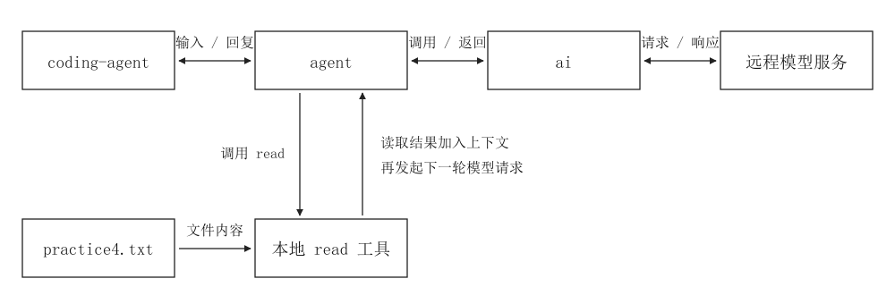

[可编辑的 Mermaid 图源](practice-04/runtime-flow.mmd) · [SVG 版本](practice-04/runtime-flow.svg)

## 7 遇到的问题及处理

### 7.1 构建时网络连接失败

普通构建曾在 `generate-models` 阶段报出 `ECONNRESET`，重试时又遇到 `UND_ERR_CONNECT_TIMEOUT`，联网获取模型目录失败。

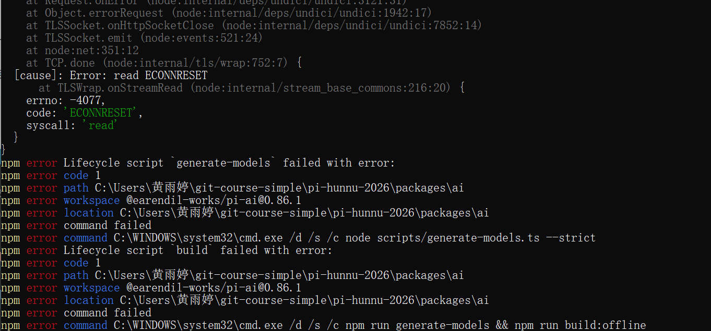

随后执行 `npm run check:model-data`，已有数据检查通过，退出码为0。当时考虑了复用数据的离线构建方案；最终成功截图对应的是重新执行 `npm run build`，并成功联网生成模型目录，不能将这一结果记为根目录离线构建成功。

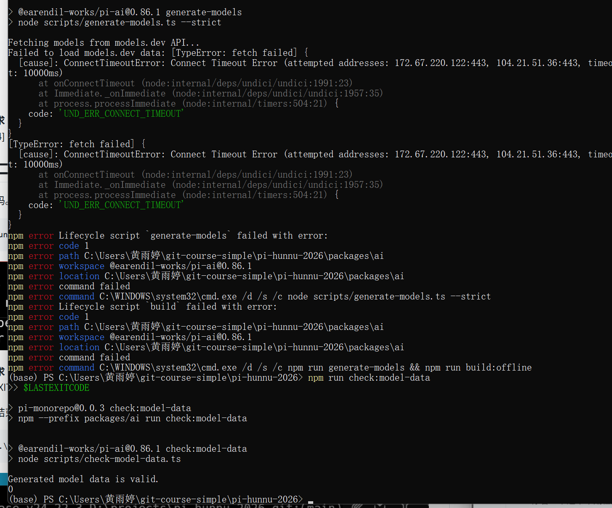

### 7.2 交互界面的日志留存与中文编码

第一次直接在交互界面观察时，回复截图中没有保留下 `[P4]` 日志，因此没有据此判断调用次数。检查源码和编译后的 `agent-loop.js`，确认两行日志已经进入产物后，改为单独保存标准错误输出。

直接在 Windows PowerShell 中使用 `2>` 后，日志中文出现乱码，还附带了 `RemoteException`、`CategoryInfo` 等包装信息。这些附加行不能重复计为模型调用。

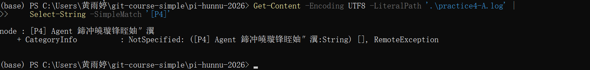

后来通过 `cmd /d /c` 完成重定向，再用 `Get-Content -Encoding UTF8` 读取，日志中文正常。报告采用第4、5节这组分别在新会话中完成的 A、B 记录进行对比。重定向只改变日志保存方式，两行源码日志和本地编译入口保持不变。

## 8 实验体会

这次通过日志看到了工具调用前后的两轮模型请求。模型先决定需要什么工具，Pi 在本地执行，再把结果交给模型继续回答。对比时也需要同时查看界面和实际日志，不能仅凭回答内容推断调用了几轮模型。
