# 实践课5 Pi Agent工具调用与会话恢复

## 1 基本信息

- 姓名：黄雨婷
- GitHub 登录名：`hhyt28`
- 小组仓库：[Learning-Rate-LR/pi-hunnu-2026](https://github.com/Learning-Rate-LR/pi-hunnu-2026)
- 本地源码：`C:\Users\黄雨婷\git-course-simple\pi-hunnu-2026`
- 分支及基础提交：`main`，`1e0fe20497ede31346957636d1ee38a2e61f69d0`
- 本地 Pi：`0.86.1`
- 对比使用的模型和思考级别：`deepseek-v4-pro`、`high`

继续使用第四次实践构建的本地 Pi，保留已有的两行 `[P4]` 日志和第三次实践对 `opencode-go.ts` 的修复。本次没有为了实验修改源码。先读取交接单，再比较恢复原会话和新建会话的回答，最后对应到源码中的函数和消息处理过程。

## 2 A阶段：读取交接单

在源码工作目录中创建 `handoff.txt`，随机生成标识 `lr-309d68eb`，文件包含两行：

```text
待办：补充 README 的启动说明
启动命令：npm run demo -- --profile lr-309d68eb
```

其中的启动命令用于本次交接实验，没有实际执行 `npm run demo`。

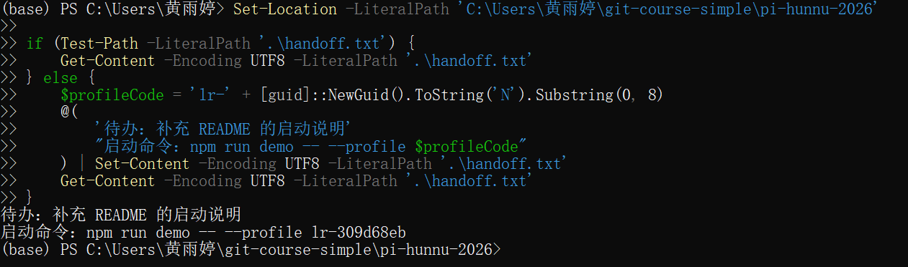

启动本地编译产物并单独保存标准错误输出，进入新会话：

```powershell
cmd /d /c "node .\packages\coding-agent\dist\cli.js 2> practice5-A-utf8.log"
```

输入时只给出文件名，没有透露其中的启动命令：

```text
请用 read 工具读取当前目录的 handoff.txt，原样告诉我待办和启动命令。
```

界面出现一次 `read handoff.txt:1`。最终回复给出了待办“补充 README 的启动说明”，以及完整命令 `npm run demo -- --profile lr-309d68eb`。

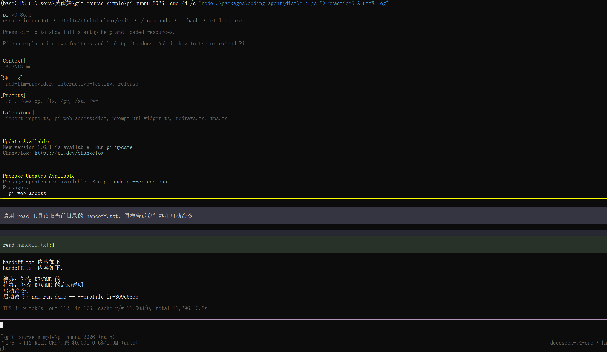

原始日志依次为：

```text
[P4] Agent 即将请求模型
[P4] 工具结果已加入上下文
[P4] Agent 即将请求模型
```

因此，这一次用户输入构成一轮交互，其中实际发生了两次模型调用、一次工具执行。

## 3 图1：单轮工具调用的代码级时序图

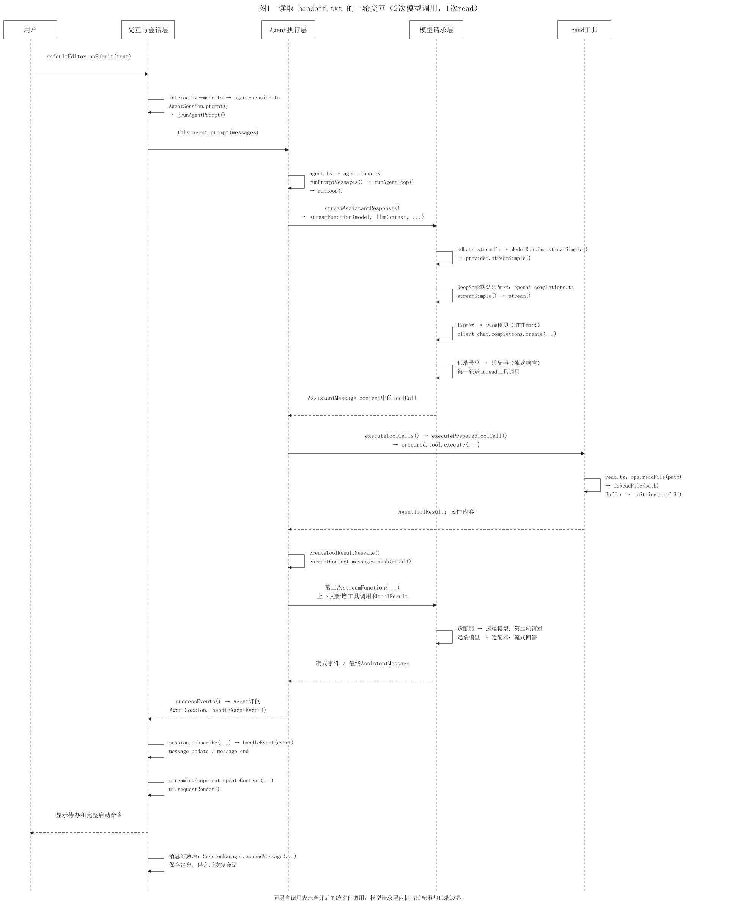

[Mermaid图源](practice-05/figure-1-sequence.mmd) · [SVG版本](practice-05/figure-1-sequence.svg)

主图按五条生命线合并同一职责层内的对象。图中的自调用和注释说明跨文件调用；模型请求层的内部箭头标明本地适配器与远端模型服务之间的请求、响应边界。

### 3.1 输入如何进入Agent循环

`interactive-mode.ts` 的 `setupEditorSubmitHandler()` 设置 `defaultEditor.onSubmit`。提交文本后进入 `AgentSession.prompt()`，其完成输入处理后调用 `_runAgentPrompt(messages)`；后者调用 `this.agent.prompt(messages)`。

`agent.ts` 中，`Agent.prompt()` 先执行 `normalizePromptInput()`，再进入 `runPromptMessages()`。该方法调用 `agent-loop.ts` 导出的 `runAgentLoop()`。它将原有上下文和新输入组合后，进入 `runLoop()`。当前这条路径直接使用 `runAgentLoop()`，不能只看到同文件中的 `agentLoop()` 就把它写成实际入口。

### 3.2 模型请求与工具结果

`runLoop()` 调用 `streamAssistantResponse()`；后者转换消息并调用 `streamFunction(config.model, llmContext, ...)`。`sdk.ts` 配置的 `streamFn` 转交给 `ModelRuntime.streamSimple()`，随后进入提供商的 `streamSimple()`。

图中按仓库 `deepseekProvider()` 的默认实现展开模型请求适配器：它使用 `openAICompletionsApi()`；`openai-completions.ts` 中的 `streamSimple()` 调用 `stream()`，后者通过 `client.chat.completions.create(params, requestOptions).withResponse()` 发起远端请求并处理流式响应。这是源码定位，不是对本次网络流量的抓包记录。

第一轮模型回复包含 `read` 工具调用。Agent 的 `executeToolCalls()` 进入工具执行流程，`executePreparedToolCall()` 实际调用 `prepared.tool.execute(...)`。返回结果经 `createToolResultMessage()` 转为工具结果消息，随后由 `currentContext.messages.push(result)` 加入上下文，再开始下一次模型请求。

### 3.3 谁读了文件，采用哪种读取方式

实际读取发生在本地 `read` 工具中。`read.ts` 的默认操作将 `readFile` 映射到 `fs/promises` 的 `readFile`（别名 `fsReadFile`）。本次文本分支执行：

```typescript
const buffer = await ops.readFile(absolutePath);
const textContent = buffer.toString("utf-8");
const allLines = textContent.split("\n");
```

这里先读入 Buffer，再解码并按行处理，没有走 `createReadStream` 的文件读取路径。模型生成的是工具调用，实际文件系统读取由本地工具完成。

### 3.4 回复如何显示和保存

Agent 通过事件把模型输出传回会话层。`AgentSession` 订阅 Agent 事件；交互界面的 `subscribeToAgent()` 又通过 `this.session.subscribe(...)` 将会话事件送入 `handleEvent()`。

`message_update` 分支执行 `streamingComponent.updateContent(..., true)` 并请求渲染；`message_end` 分支完成回复更新。用户因此在终端中看到待办和启动命令。`AgentSession._handleAgentEvent` 在消息结束时还通过 `SessionManager.appendMessage(event.message)` 保存用户、助手及工具结果等消息，为之后恢复历史提供记录。

## 4 B阶段：恢复旧会话与新建会话

### 4.1 恢复旧会话

A结束后退出Pi，在同一个工作目录重新启动并加上 `-c`：

```powershell
cmd /d /c "node .\packages\coding-agent\dist\cli.js -c 2> practice5-continue-utf8.log"
```

界面恢复了A的提问、`read`记录和交接单回复。

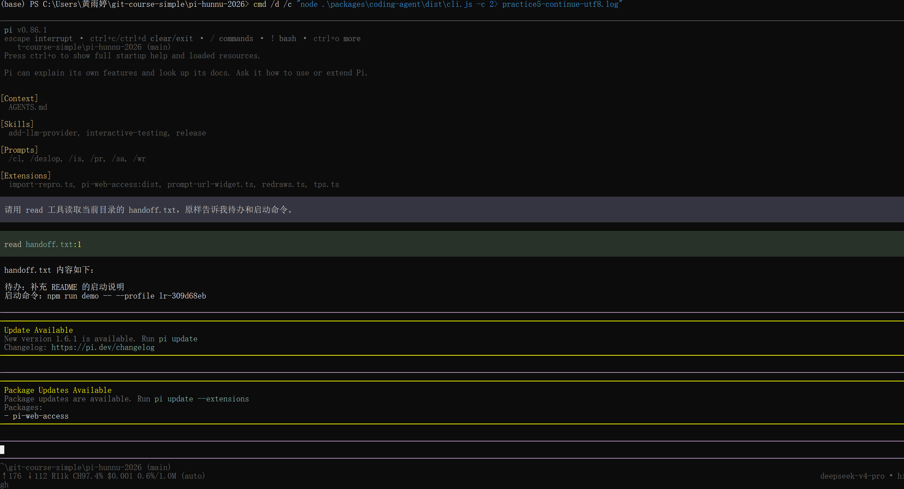

输入：

```text
接着上次的待办，给 README 起草一条启动说明，写出交接单里的完整启动命令。只用这次会话已有的信息。不要调用工具。如果缺少命令，请直接说明。
```

Pi给出了README启动说明草稿，包含完整命令 `npm run demo -- --profile lr-309d68eb`。回复还说明本次会话没有提供demo用途、环境要求或profile含义等更多背景。这次问答没有出现新的工具执行记录。恢复界面上已有的 `read` 是A的历史记录，不能算成本次重新读取。

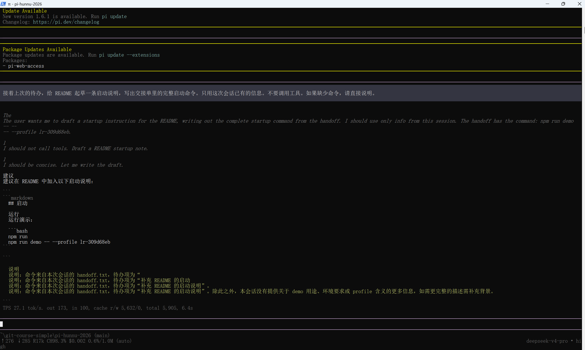

本次只是让Pi在回答中起草文字，没有要求它实际写入README。恢复后能写出随机标识对应的完整命令，且没有重新读文件，支持它使用了已恢复的会话历史。

### 4.2 新建会话

在同一个Pi进程中执行 `/new`，界面提示 `New session started`，模型和思考级别保持不变。

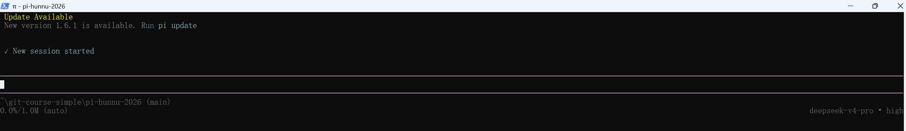

随后输入与恢复后完全相同的问题，不补充交接单内容。Pi回答“我没有可以用的信息”，说明本会话没有交接单内容和启动命令记录，并请求提供命令或交接单路径。此次也没有调用工具。

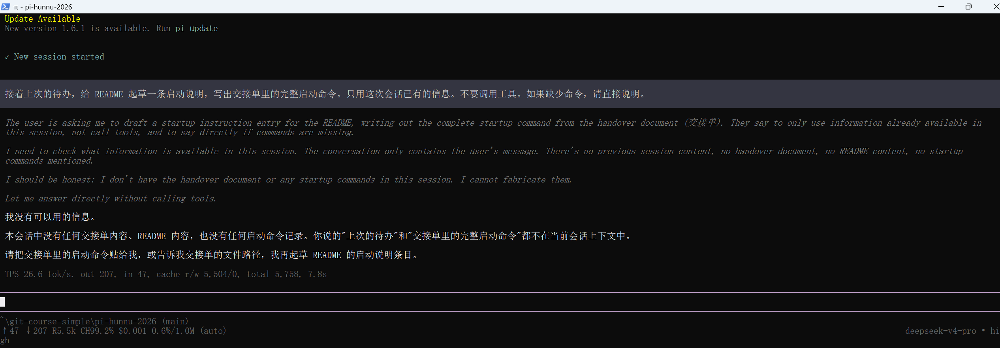

### 4.3 日志与对照结果

退出后按UTF-8读取两份日志。A有两条模型请求日志和一条工具结果日志；第二份文件包含恢复问答和 `/new` 后问答，合计两条模型请求日志，没有工具结果日志。结合分别保留的问答截图，后两次问答各有一次模型请求。

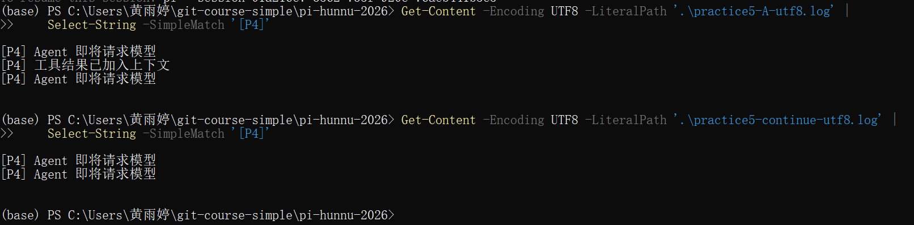

| 阶段 | 是否调用工具 | 模型调用次数 | 结果 |
|---|---|---|---|
| A：读取交接单 | 一次read | 2次 | 读到待办和完整命令 |
| 恢复原会话后提问 | 未调用 | 1次 | 使用历史中的完整命令起草说明 |
| /new后相同提问 | 未调用 | 1次 | 说明缺少交接单和命令 |

[交接单副本](practice-05/handoff.txt) · [A原始日志](practice-05/practice5-A-utf8.log) · [恢复与新会话的合并日志](practice-05/practice5-continue-utf8.log)

## 5 图2：恢复旧会话与新建会话的对照图

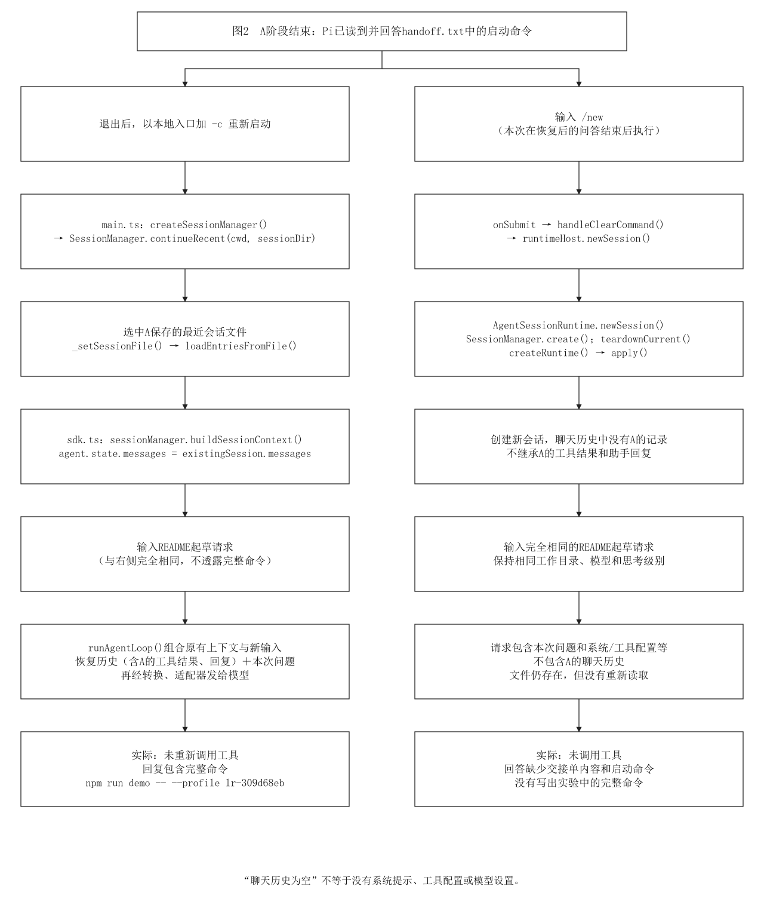

[Mermaid图源](practice-05/figure-2-sessions.mmd) · [SVG版本](practice-05/figure-2-sessions.svg)

两条分支都以A已结束、Pi已读到并回答启动命令为起点。本次实际先进行了恢复问答，然后执行 `/new`；右分支表示新会话不继承A历史的效果。

恢复路径中，`main.ts` 的 `createSessionManager()` 识别 `parsed.continue`，调用 `SessionManager.continueRecent(cwd, sessionDir)`。它选择最近的会话文件，经构造和 `_setSessionFile()` 调用 `loadEntriesFromFile()` 装载记录。后者用 `openSync/readSync` 分块解码并解析会话条目，不能与 `read` 工具读取交接单的实现混淆。

`sdk.ts` 的 `createAgentSession()` 调用 `sessionManager.buildSessionContext()`，再将 `existingSession.messages` 赋给 `agent.state.messages`。之后 `runAgentLoop()` 把恢复的上下文与本次输入组合，经消息转换用于模型请求。因此，A的工具结果和助手回复可以参与恢复后的问答。

新建路径中，`onSubmit` 识别 `/new`，调用 `handleClearCommand()`，再调用 `runtimeHost.newSession()`。`AgentSessionRuntime.newSession()` 创建新的 `SessionManager`，通过 `teardownCurrent()`、`createRuntime()`、`apply()` 替换运行会话。普通 `/new` 不带setup参数，因此不会把旧会话消息注入新会话。

这里的“新会话为空”指没有A的聊天历史，不表示没有系统提示、工具配置和模型设置。当前目录里的 `handoff.txt` 仍然存在，但在没有再次读取的情况下，其内容不会因为文件存在就自动成为新会话的聊天消息。

## 6 代码位置与适合修改的位置

| 观察或修改目标 | 对应位置 |
|---|---|
| 输入提交、内置命令识别 | `interactive-mode.ts`：`setupEditorSubmitHandler`、`defaultEditor.onSubmit` |
| 提问封装与调用Agent | `agent-session.ts`：`prompt`、`_runAgentPrompt` |
| Agent执行与工具结果入上下文 | `agent.ts`：`prompt/runPromptMessages`；`agent-loop.ts`：`runAgentLoop/runLoop/executeToolCalls` |
| 请求参数和远端响应适配 | `model-runtime.ts`：`streamSimple`；`providers/deepseek.ts`；`api/openai-completions.ts`：`streamSimple/stream` |
| 文件读取、按行选取和截断 | `core/tools/read.ts`：`createReadToolDefinition`及文本分支 |
| 回复显示 | `interactive-mode.ts`：`subscribeToAgent/handleEvent`及`message_update/message_end` |
| 会话文件与历史恢复 | `session-manager.ts`：`continueRecent/loadEntriesFromFile/buildSessionContext`；`sdk.ts`：恢复消息赋值 |
| 新会话替换 | `agent-session-runtime.ts`：`newSession` |

以上位置用于定位功能。本次仅阅读这些代码，没有将交接单中的demo命令当成真实开发脚本，也没有修改README。

## 7 源码阅读截图

<details>
<summary>输入、读取和回复显示</summary>

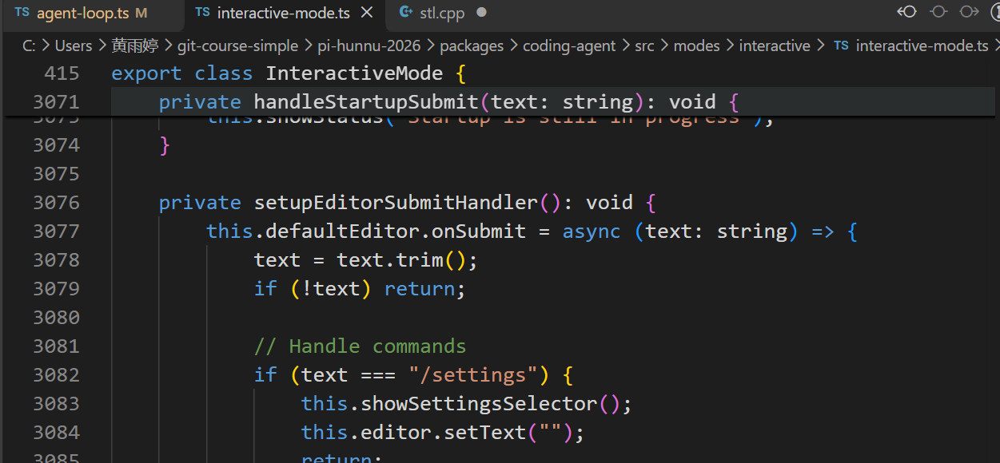

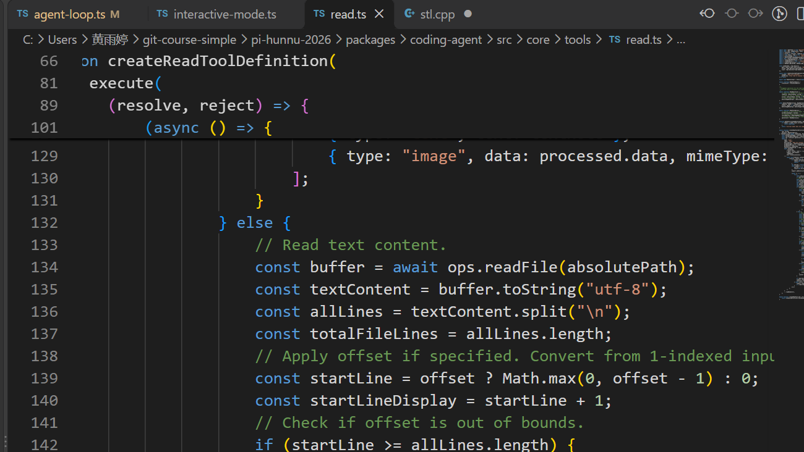

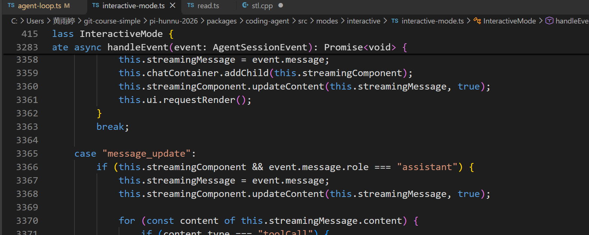

</details>

<details>
<summary>会话层进入Agent与恢复入口</summary>

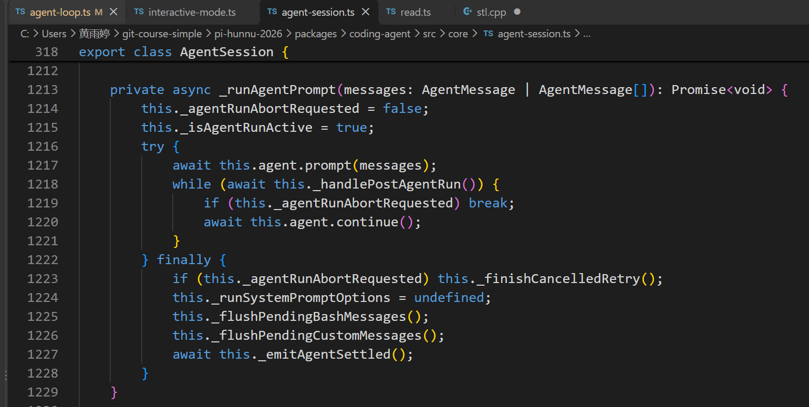

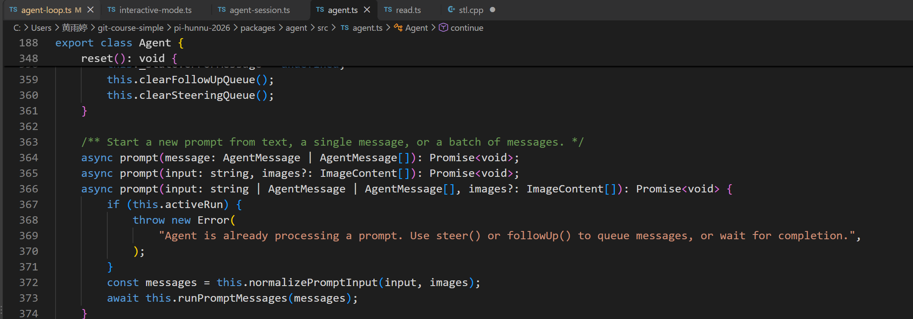

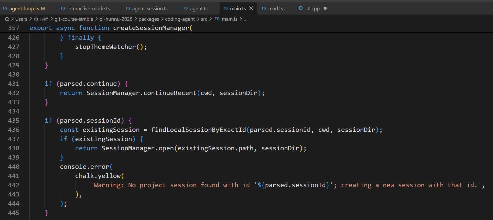

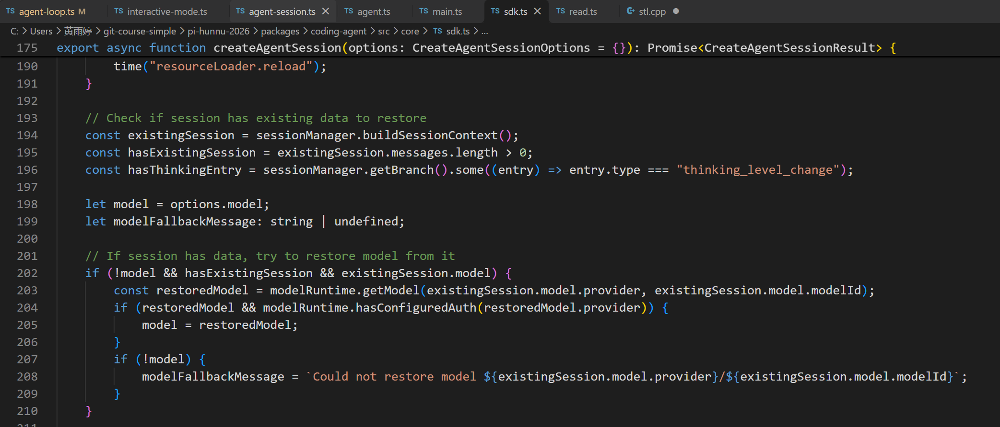

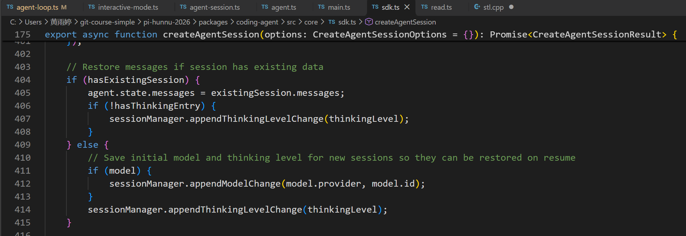

</details>

<details>
<summary>新建会话的识别与运行会话替换</summary>

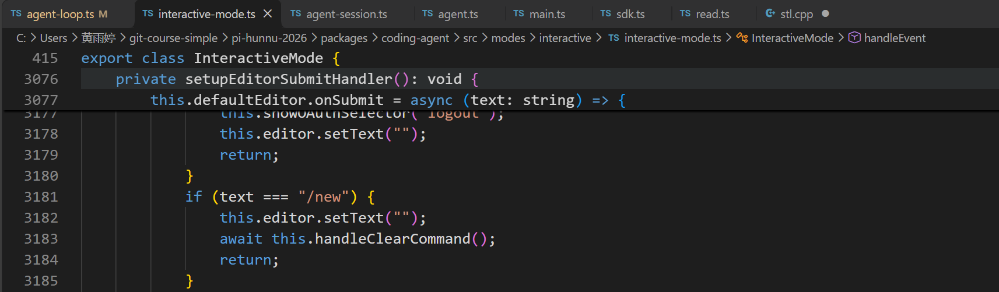

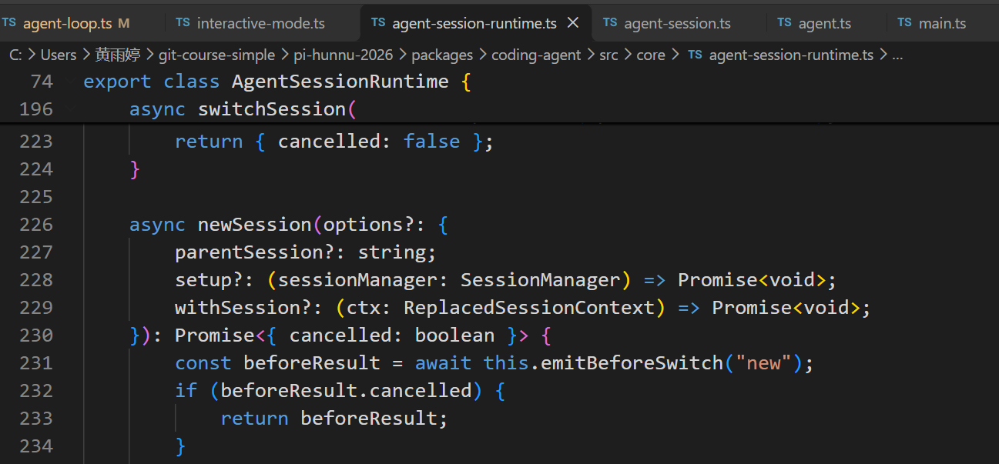

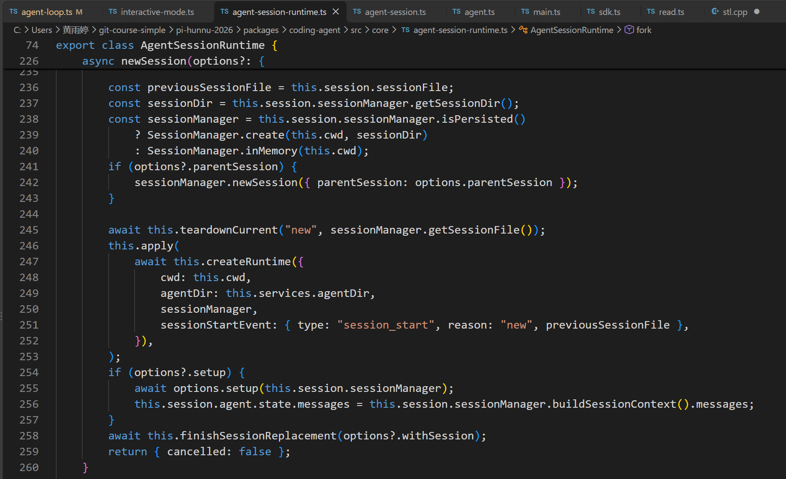

</details>

## 8 阅读体会

这次从实际操作回到代码后，我能把“模型提出工具调用”和“本地工具读取文件”区分开，也看到了恢复消息赋值的位置。两次相同提问的不同回答，与是否带入旧聊天历史相对应；`/new` 改变的是会话历史，并没有删除工作目录中的文件。

这让我注意到，使用同一个模型、处在同一个目录，并不代表两次提问拥有相同的信息。继续已有任务时，需要确认会话是否恢复；开始独立任务时，也要重新提供必要背景。阅读源码时，沿着输入、工具执行、消息保存和恢复的路径查找，比只记住文件名更有帮助。两张图也让我把分散在不同文件中的调用关系整理得更清楚。

这也提醒我，会话恢复保存的是可供后续使用的历史记录，模型能否继续完成任务，还取决于这些记录中是否包含所需的信息。
